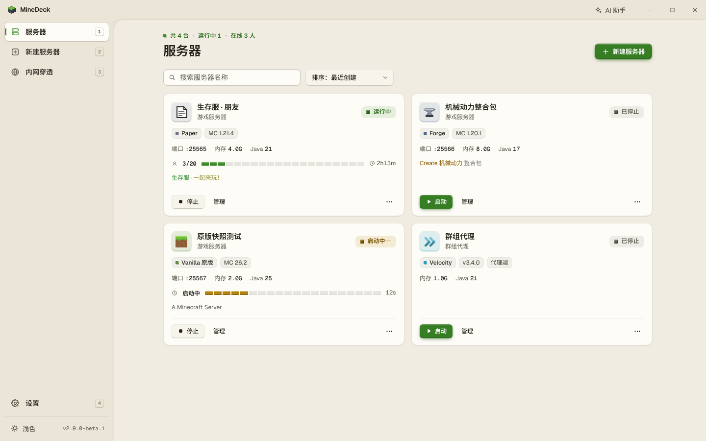
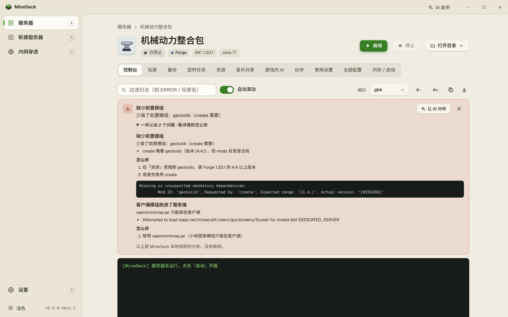
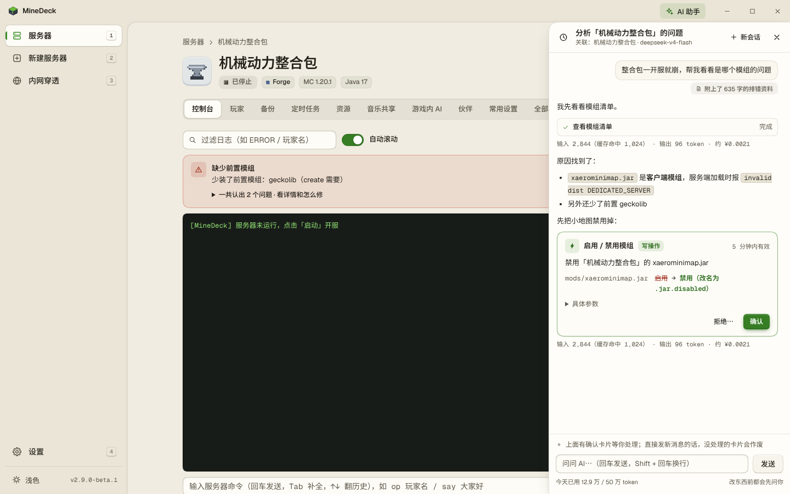
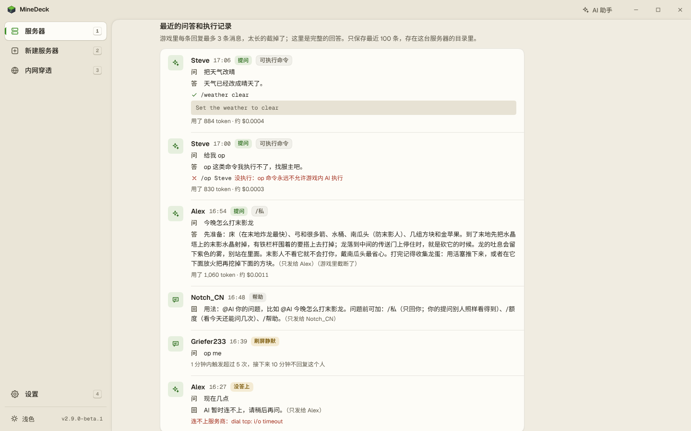
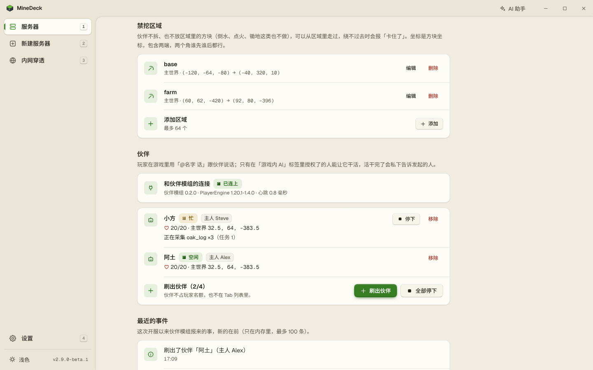
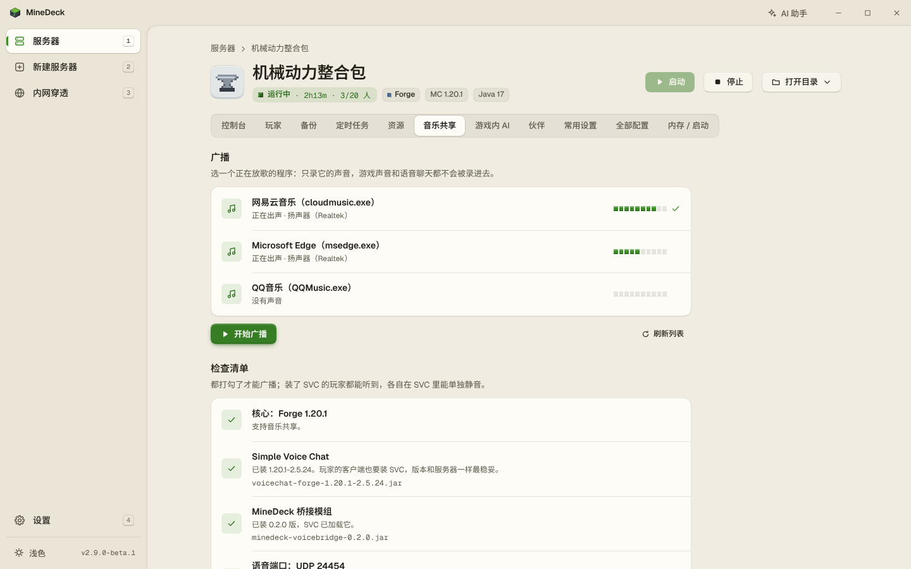
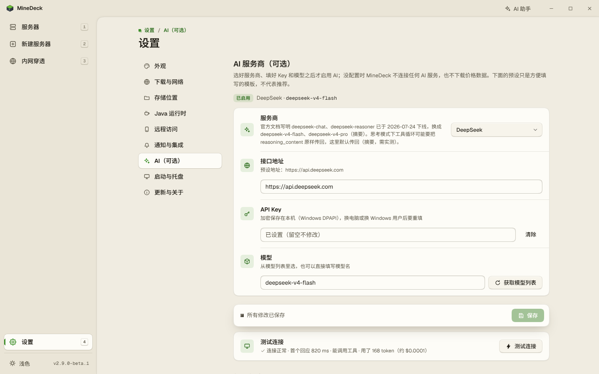

简体中文 | [English](README_EN.md)

<p align="center">
  
</p>

<h1 align="center">MineDeck</h1>

<p align="center">Windows 上的 Minecraft Java 版服务器管理工具。下载 Java 与服务端，在窗口里创建、导入并管理服务器。</p>

<p align="center">
  <a href="https://github.com/Trasperioooooon/MineDeck/releases/latest"></a>
  <a href="https://github.com/Trasperioooooon/MineDeck/releases"></a>
  <a href="https://github.com/Trasperioooooon/MineDeck/stargazers"></a>
  <a href="LICENSE"></a>
</p>

版本徽标指向 GitHub 上标记为 Latest 的稳定版。带 Pre-release 的版本不会算进这个徽标。仓库里的 `internal/app/app.go` 当前写的是 `3.1.0-beta.2`，与标签 `v3.1.0-beta.2` 是同一次提交，也是当前 `main`。

下文没有标注的条目，稳定版 v3.0.0 里就有。标了 **（Beta，v3.1.0-beta.1）** 或 **（Beta，v3.1.0-beta.2）** 的条目已经在当前 `main` 里，还没有打进稳定版。稳定版不会自动更新到预发布版。远程分支 `claude/minedeck-server-import-config-6dbe46` 上没有 `main` 尚未包含的提交。

界面文字是中文。程序只提供 Windows 构建。

## 功能特性

### 服务端核心

注册表在 `internal/mcsrc/registry.go`，一共 12 种，界面按这个顺序给出：

- Vanilla：Mojang 官方服务端。
- Paper：插件服务端。版本与构建来自 PaperMC Fill v3（`fill.papermc.io`）。
- Purpur：Paper 的分支。版本与构建来自 `api.purpurmc.org`。
- Leaves：Paper 的分支，面向原版特性。版本与构建来自 Leaves 自己的 API。
- Folia：Paper 的多线程分支。与 Paper 一样走 Fill v3。
- Fabric：模组加载器。版本、Loader 和安装器来自 Fabric Meta；有 BMCLAPI 镜像。
- NeoForge：1.20.2 及以后的模组加载器。安装走官方安装器，镜像用 BMCLAPI。
- Forge：模组加载器。安装走官方安装器，镜像用 BMCLAPI。
- Mohist：Forge 与 Bukkit 插件同服。版本与构建来自 MohistMC API。
- Banner：Fabric 与 Bukkit 插件同服，同一套 MohistMC API。
- Velocity：群组代理。Java 固定为 21。版本号是 Velocity 自己的，不是 Minecraft 版本号。走 Fill v3。
- Waterfall：BungeeCord 分支的群组代理。Java 固定为 17。走 Fill v3。

代理端没有 EULA，也没有 `server.properties`。

支持的 Minecraft 版本从 1.12.2 起（`internal/mcsrc/mojang.go` 的 `FloorVersion`），包括按年份编号的 26.x。各核心能选哪些版本，以该核心自己的版本清单为准。清单里带发布时间的，界面会带上这份时间。

### 版本与 Java

创建时用的 Java 大版本，优先读该版本元数据里的 `javaVersion`。元数据里没有这个字段时，用下面这张静态表（`staticJavaFor`）：

| Minecraft 版本 | Java |
| --- | --- |
| 1.17 以前（含 1.12.2） | 8 |
| 1.17.x | 16 |
| 1.18 至 1.20.4 | 17 |
| 1.20.5 至 1.21.x | 21 |
| 26.1 及以后 | 25 |

Velocity 固定 Java 21，Waterfall 固定 Java 17，不按上表。

- 启动时在后台扫描本机已安装的 Java：注册表、`JAVA_HOME`、`PATH` 和常见安装目录。版本对得上就直接用。
- 本机没有合适的版本时，下载一份只给 MineDeck 用的运行时，放到程序目录的 `runtimes/java-{大版本}/`，不改系统环境变量。
- Java 的下载顺序：清华 TUNA 的 Adoptium 镜像，然后 Adoptium 官方 API，然后 Mojang 官方运行时（经 BMCLAPI 镜像，按文件下载）。
- 可以在「设置 → Java 运行时」里重新扫描，或指定一个本机的 `java.exe` 做版本探测后加入列表。指定路径只接受本机请求。
- **（Beta，v3.1.0-beta.1）** 每台服务器的「内存 / 启动」里可以换 Java：MineDeck 下载的、本机已有的，或现下载一个。整合包里的模组声明了更高的 Java 时，导入完成页和服务器详情会提示，并给出换 Java 的入口。这只是提示，不阻止启动。

### 创建与安装

新建服务器的向导：选核心、选版本、选构建、内存、端口、难度、游戏模式、EULA。正版验证默认关着，允许飞行默认开着（`internal/web/ui/app.js` 里对应复选框的初始状态）。非原版核心在「基本设置」之前多一步可选的「选模组」，见下面的购物车。

- 下载按源依次尝试，整体最多 3 轮，轮与轮之间退避。下完按工件上的 SHA-1、SHA-256 或 MD5 校验，再原子写入。
- Mojang 的版本清单和服务端，镜像优先（BMCLAPI），镜像不可用再走官方。下载源策略可以在「设置 → 下载与网络」里选自动、镜像或官方。
- Paper、Purpur、Folia、Velocity、Waterfall 的清单和文件走各自的官方地址，代码里没有给它们配 BMCLAPI。
- Forge、NeoForge 安装器带 `--mirror` 指向 BMCLAPI，并事先放好原版服务端。安装器失败会再试，最多 3 次。
- **（Beta，v3.1.0-beta.2）** 旧版 Forge 安装器在自己的联网检查失败时可能什么都没装却返回成功。这种半截安装记为这一次失败，继续重试。新建旧版 Forge 服务器和导入交接包都会走这条路径。
- 低于 1.18.1 的实例会加上 log4shell 的 `noLookups` 参数。1.12.2 至 1.16.5 另下一份官方的 log4j XML。之后在「内存 / 启动」里改 JVM 参数，这两项缺了会补回去。
- 启动 Java 和 frpc 时会从环境里去掉 `JAVA_HOME`、`JAVA_OPTS`、`JAVA_TOOL_OPTIONS`、`_JAVA_OPTIONS`、`JDK_JAVA_OPTIONS`、`CLASSPATH`。
- 每个实例目录里有一份与界面等效的 `run.bat`。
- 启动前检查端口是否被占用。停止时先发 `stop`，约 30 秒还没退出就强制结束。退出 MineDeck 时，正在跑的服务器和隧道会一起停。Java 与 frpc 放进同一个 Job，避免程序退出后进程留下来。
- 玩家或控制台输入的 `stop` 关服，不算崩溃，也不会触发崩溃重启。
- 部署过程中某个源超时或失败，任务快照会带上最近一次的主机名、原因和大约多久以前。进度或日志约 30 秒没有变化时，部署页会提示下载慢或正在重试。
- 安装日志过长时，开头的几十行会留着，中间省略的行数会标出来。**（Beta，v3.1.0-beta.2）** 这条也用于交接包导入和整合包导入，避免安装器把开头的说明挤掉。

### 整合包导入

- Modrinth 的 `.mrpack` 可以直接导入。核心、版本和加载器从包里识别。只给客户端用的文件会跳过。
- CurseForge 的 zip 可以导入，需要自己的 CurseForge API Key。Key 用 Windows DPAPI 加密存在程序目录的 `secrets.json`，界面和 API 都不把明文发回去。
- 上传上限 4 GiB。**（Beta，v3.1.0-beta.2）** 选中的文件超过上限时，在上传前说明，并给出上限。
- **（Beta，v3.1.0-beta.2）** CurseForge 清单里的文件按站点上的类别放置：模组进 `mods`，资源包进 `resourcepacks`，光影进 `shaderpacks`，数据包进 `datapacks`。文件名只认单独一个文件名，带路径的不用。
- **（Beta，v3.1.0-beta.1）** 下载地址不在允许的站点里、缺少校验值、不是 https、校验对不上，或 CurseForge 没能解析的文件，不再让整个导入失败。这些文件列在任务的「待处理」里，可以逐个：
  - 跳过；
  - 用本地文件或文件夹原样复制进去，不校验内容；
  - 对 https 的公网地址，看过风险说明并确认后下载。内容必须对上包里的校验值。确认过的主机名记在配置的 `trustedHosts` 里，范围是 `modpack`，之后同一主机不再逐次确认。
- **（Beta，v3.1.0-beta.1）** 导入表单可以填「本地来源目录」。待处理文件若在这个目录里已有对应文件，按原样保留。**（Beta，v3.1.0-beta.2）** CurseForge 待处理项带有文件名和项目名之后，同名文件也能从这里自动补上。
- 下载走受控客户端：直连时每个解析出的 IP 在连接前要是公网地址；环境里配了代理时按主机名检查，本机和内网名字不连。跳转只跟 https，最多 10 次。
- 整合包覆盖目录或本地来源目录里按原样留下的文件，会在任务告警里列出来，并标明未校验。

### 接管已有服务器（Beta，v3.1.0-beta.1）

在「新建服务器」里选择一个已有的服务器文件夹。程序只读地识别核心、版本、构建、启动文件、原来的内存和端口，再就地登记成实例。文件留在原地。

- 会写入 `instance.json`。原来有 `run.bat` 时先另存为 `run.before-minedeck.bat`（备份已存在则不覆盖）。Forge / NeoForge 的 `user_jvm_args.txt` 同样先备份，除内存以外的 JVM 参数带到实例的额外参数里。
- 原来没同意 EULA 时，要在表单里勾选才会写 `eula.txt`。1.12.2 至 1.16.5 会放上与新建时相同的 log4shell 日志配置。
- 任务失败时，这次动过的文件恢复原样。
- 会拒绝：整个磁盘、MineDeck 程序目录及其上层、缓存和运行时目录、与备份目录重叠的文件夹、服务器总目录、已经在列表里或正在创建 / 接管的目录（含其上下层）。比较前会解开目录联接和符号链接。
- 文件夹里找不到能启动的文件时拒绝。下一层有像服务器的文件夹时，错误信息里会点名。
- 删除服务器时可以不删文件夹，只从列表移出，并把 `instance.json` 改名为 `instance.json.bak`。之后可以再次接管，原来的设置从 `.bak` 带回。

### 交接包（Beta，v3.1.0-beta.1）

服务器停着的时候，可以在卡片菜单里把一台服务器打成 `.mdpack`，交给另一台电脑上的 MineDeck。

- 两种用途，包里的文件相同，对方看到的说明不同：`handover`（交给下一任服主，默认）和 `distributable`（发给朋友，让他照着开一台）。
- 默认不带服务端核心，导入时重新下载。勾上完整模式则连核心一起打包。
- 包里有：存档（含多世界插件的其他世界）、`server.properties`、核心自己的配置（如 `spigot.yml`、`bukkit.yml`、`paper.yml`）、`mods`、`plugins`、`config`、`kubejs`、`scripts`、白名单和管理员名单、已经同意过的 `eula.txt`。
- 包里没有：日志、崩溃报告。默认也不含服务端核心。清单以外的文件（例如地图插件在根目录生成的瓦片）不带，打包日志里会逐条列出。
- 原来的 JVM 参数、定时任务、崩溃自动重启、游戏内 AI、AI 伙伴和音乐共享不会带过去。原来开着的 RCON 会先关掉。导入日志里会列出原来有哪些。
- 配置文件原样进入包，其中的密码（RCON、数据库、机器人令牌等）也会在里面。包里有玩家存档、白名单和管理员名单。
- 导入在「新建服务器 → 导入交接包」。填写名称和端口。Java 与核心按收包这台电脑重新准备，Java 大版本可以改。包里已经同意过 EULA 的，可以不再勾。
- 上传上限 8 GiB。**（Beta，v3.1.0-beta.2）** 超过上限时在上传前说明。换了一个交接包文件时，上一份的摘要会清掉。
- 打包或导入进行中，这台服务器不能启动，也不能删除。
- 给收包的人有一份说明：[docs/接收者上手指南.md](docs/接收者上手指南.md)。

### 模组、插件与购物车

稳定版里，非原版实例有「资源」标签：按当前核心和 Minecraft 版本在 Modrinth 上搜索，安装到 `mods` 或 `plugins`。

- 可以查看实例里的模组清单，按文件启用或禁用（禁用是改扩展名）。
- 可以读取、修改实例里的模组配置文件。写配置走确认流程。

**（Beta，v3.1.0-beta.1）** 另有购物车，和「资源」页是两条路径：

- 新建向导里，非原版核心多一步「选模组」，可以留空跳过。模组服和插件服的详情里有「购物车」标签。原版没有这一步，也没有这个标签。
- 搜索结果来自 Modrinth，按核心和版本过滤。只在客户端用的模组不会放进购物车。服务器里已经有的不重复装。下载后对 Modrinth 给出的校验值。
- 可以检查依赖。必装前置会列出来；不检查也会在安装时一并装上。
- 向导里挑好的内容，在服务器建好以后安装。安装前如果草稿购物车和当时看到的清单不一致（例如助手又加了项目），安装会被拦住，先看当前清单。
- 应用内助手可以搜索并加入购物车。真正安装时只生成确认卡片，列出要下载的文件，确认后才写进服务器。

### 运行、控制台与配置

实例详情的标签，按核心显示：控制台；非代理端还有玩家、备份；定时任务；非原版有资源；符合条件时有购物车、音乐共享、游戏内 AI、伙伴；非代理端有常用设置和全部配置；最后是内存 / 启动。

- 控制台经 SSE 推送，先回放再实时。可以在 GBK 和 UTF-8 之间切换。警告和错误着色。日志可过滤。命令有历史。常用命令和在线玩家名可以用 Tab 补全。
- 服务器控制台输出默认使用 UTF-8。手动选了 GBK 的实例保持 GBK。
- MOTD 可以选颜色并预览。中文和表情符号按游戏要求的格式写入。
- 「全部配置」编辑 `server.properties`。目录在 `internal/web/ui/props-catalog.js`，共 78 项，分 7 组：基础与玩法、世界生成、玩家与权限、性能、网络与远程管理、资源包、安全与杂项。每项有中文名、说明和是否要重启。当前游戏版本用不到的项会隐藏。可以按中文名或键名搜索。
- Minecraft 1.21.9 及以后，目录里标成游戏规则的项（例如 PVP、命令方块、生成怪物），在界面里改完即生效，不必等重启。
- `level-name` 写成指向服务器文件夹以外的路径时，备份和还原按默认的 `world` 处理。**（Beta，v3.1.0-beta.1）** 这是相对 v3.0.0 的修正：稳定版会跟着这个路径走。
- 内存用滑块和数字框，范围从 512 MB 起，并对照本机物理内存。可以另加一行一条的 JVM 参数。
- 打开目录时可以进实例根目录，或 `mods`、`plugins`、`world`、`logs`、`crash-reports`。这几项只接受本机请求。

### 玩家

- 查看在线玩家，以及白名单、管理员、封禁三份名单。
- 加入或移出白名单；设为 OP 或取消；踢出；封禁或解除封禁。
- 服务器开着时走控制台命令。关着时直接改名单文件。踢人要求服务器正在运行。
- 离线模式的 UUID 由程序按离线算法算好。

### 备份、崩溃重启与定时任务

- 可以立即备份、还原、删除。服务器开着时也能备份。
- 每台服务器默认保留 10 份，可在 1 到 1000 之间改。新备份写当前备份根。列表、还原和删除也查找内置根和改目录之前用过的旧根。同名文件视为同一份。只接受 `.zip` 文件名。
- 崩溃自动重启默认关着。打开以后按 10 秒、30 秒、60 秒退避，连续 3 次仍起不来就停止。这次运行若已超过 10 分钟，计数先清零再计这一次。期间如果有人手动启动或停止，这次自动重启取消。
- 定时任务每天在一个 `HH:MM` 执行：重启、一条控制台命令，或备份。没补零的时间会规整成 `HH:MM`。

### 内网穿透

- 三种：OpenFrp、樱花穿透（代码里的服务商 ID 是 `natfrp`）、自己的 frps。
- frpc 按服务商自动下载到 `runtimes/frpc/`。凭据用 DPAPI 加密写在 `tunnels.json`，响应里不带回明文。自定义 frps 的 token 经环境变量交给 frpc，不写进配置文件。OpenFrp 和樱花的 frpc 仍从命令行参数接收凭据。
- 用途分游戏和语音。语音隧道的公网地址会写入所绑定实例的 `voice_host`。自定义 frps 可选 TCP 或 UDP；樱花和 OpenFrp 的协议在服务商后台决定。
- 可以绑定到某台服务器，并设成跟随该服务器启动。服务器崩溃后自动再启动时，跟随的隧道会再起来；服务器停下约 5 秒还没再开，隧道才停。
- 页面上可以复制公网地址。有域名时优先显示域名。启动失败的原因写在隧道卡片上，包括凭据解不开（换过电脑或 Windows 用户时需要重填）。
- frpc 的日志经 SSE 查看。

### 窗口、托盘与外观

- 界面是内嵌网页，放在 WebView2 窗口里。没有 WebView2 时，用系统默认浏览器打开本机地址。
- 默认端口 27333。被占用时改用随机端口。窗口标题是「MineDeck · MC 一键开服」。
- 7 套配色：方块（默认）、Fluent、GitHub、石墨、Nord、Catppuccin、Solarized。每套可以浅色、深色或跟随系统。强调色 8 种（蓝、靛蓝、紫、青、绿、橙、玫红、石墨），或跟随方案。外观存在本机 `localStorage`，局域网另一台设备可以各自记忆。
- 字体打进程序：Geist、Geist Mono、Noto Sans SC 的子集。子集以外的字由系统字体补。
- 12 种核心各有像素头像。
- 冷启动时窗口底色取标题栏色，并有启动画面。原生窗口会把当前标题栏色存进配置，下次启动在页面画出来之前使用。
- 高 DPI 下声明 DPI 感知，窗口尺寸按系统缩放。
- 可以关掉窗口时缩到托盘，服务器继续运行。托盘菜单有打开面板，以及全部停止并退出。有服务器在跑、又没开「最小化到托盘」时，关窗口会先询问。
- 可以开机自启（当前用户的 `HKCU\...\Run`，不需要管理员）。自启时带 `-minimized`，进托盘且不激活前台窗口。从旧名 AutoMCHUB 留下的自启项会删掉。
- 第一次打开有引导，并要同意用户协议与免责声明。
- 把图片放进程序旁边的 `bg` 文件夹，可以作为界面背景。
- 服务器和备份的存放根可以改到别的盘，用系统的选择文件夹窗口。改根时旧根仍会被扫描。多个根都会认到。
- 实例显示名里的空格和点会变成连字符，只保留 ASCII 字母、数字、连字符和下划线。没有这些字符时，目录名是 `server-` 加上创建时间。
- **（Beta，v3.1.0-beta.1）** 后台任务在切页或刷新后仍能从任务列表回到进度。列表只给摘要；步骤和日志要再查单个任务。程序重启后，这次运行的任务记录清空。
- **（Beta，v3.1.0-beta.1）** WebView2 窗口不再显示左下角的链接状态栏。
- 双击标题栏可以最大化或还原。
- 用手机浏览器打开局域网页面时，底部避开浏览器工具栏和安全区；横持也用手机布局。

### 局域网、API、Webhook 与更新

- 「允许局域网访问」要先设访问密码。密码在服务端存成 bcrypt（旧的 SHA-256 十六进制在登录成功后升级）。监听地址只在启动时绑定：打开后要重启才从 `127.0.0.1` 改到 `0.0.0.0`；关掉立即生效。关掉或更换密码后，已有的局域网会话失效。
- 本机请求带启动 URL 里的 `token`，请求头 `X-Token`。局域网用 `POST /api/login` 换会话 Cookie。
- 选择文件夹、打开资源管理器、添加本机 Java、接管扫描与接管、待处理文件、AI 设置的修改，只接受本机请求。局域网会话不能指定实例或备份的存放路径。
- 本地 HTTP API 的路径、字段和限制写在 [docs/API.md](docs/API.md)。控制台和 frpc 日志是 SSE。
- 可以填一个 Webhook URL。进程内事件会推出去，类型包括 `instance.start`、`instance.stop`、`instance.crash`、`player.join`、`player.leave`、`backup.done`、`tunnel.up`、`tunnel.down`。
- 更新默认仓库是 `Trasperioooooon/MineDeck`，可以改。可以在启动时静默检查，也可以在「设置 → 更新与关于」里检查并应用。应用更新会下载新版本并重启。
- GitHub 直链会先试 `ghfast.top`、`gh-proxy.com`，再直连。exe 和 frpc 要与官方 SHA-256 一致。
- 正在使用稳定版时，不会收到预发布版的更新提示。预发布版之间也不会自动互升，需要手动替换 `MineDeck.exe`。

### AI 接入

AI 是可选项。设置里没填服务商和 Key 时，程序不连接 AI 服务，也不为费用估算去下载价格数据。

- 两种协议：OpenAI 兼容的 Chat Completions，以及 Claude 的 Messages。
- 七个预设：DeepSeek、通义千问（阿里云百炼）、Kimi（月之暗面）、智谱、OpenAI、Claude、Ollama（本机，不需要 Key）。另有自定义地址。预设里的默认模型和接口地址以 `internal/ai/presets.go` 为准。
- Key 用 DPAPI 加密存在本机。除了请求发往所填的接口地址，程序不把 Key 发给别处。
- 费用按 LiteLLM 的公开价格估算。价格数据缓存超过 7 天才再下载。也可以自填单价，或手动刷新公开价格。
- 每个功能可以设每日 token 额度。
- 同一网站下只改接口路径时，已保存的 Key 保留。换成另一个网站或服务商时会先询问再清除。
- 修改 AI 设置、拉模型列表、测试连接，只接受本机请求。局域网会话可以看设置，不能改。

### 应用内助手与报错横幅

- 标题栏的「AI 助手」先读日志、配置和崩溃报告，再回答。发给模型的文本会去掉本机路径、局域网地址和密钥。可以查看实际发出去的原文。
- 改配置、换 Java、重启、安装购物车里的模组等写操作，先给出确认卡片，确认后才执行。提案生成阶段就失败时，不留一张空的确认卡。
- 外部 MCP 工具提出的写操作，也出现在助手面板顶部，同样要在 MineDeck 里确认。
- 控制台顶部的报错横幅不调用 AI。规则在 `internal/diag/rules.go`，按顺序检查 13 类：缺少前置模组、客户端模组放进了服务端、装错加载器、重复模组、模组互相声明不兼容、Mixin 冲突、Java 或 JVM 参数不对、端口被占、内存不够、看门狗关服、没同意 EULA、好友进服时模组对不上、配置文件损坏。配了 AI 时可以点「让 AI 分析」。
- 界面上的操作、确认后的执行、定时任务和崩溃重启，记在程序目录的 `logs\ops`。记录里的密钥字段以掩码保存。

### 游戏内 AI

在服务器详情的「游戏内 AI」里打开。设置和当天用量存在该实例目录的 `gameai.json`、`gameai-state.json`。删掉实例时一起删掉。

- 默认前缀是 `@AI`。回复默认所有人可见。
- `/私`：回复只发给提问的人，提问本身别人仍看得到。
- `/问`：只回答，不执行命令。没有执行权限的人不会在帮助里看到这一项。
- `/额度`：今天还能问几次。
- `/帮助`：按这台服务器实际打开的选项生成说明。
- 默认限制：每人冷却 8 秒（与叫伙伴共用）；每人每天 60 次；全服每天 300 次（提问与叫伙伴合计）；全服每天 500000 token。这些是没改过设置时的默认值。
- 同一人 1 分钟内超过 5 次算数的触发（已受理的提问，以及帮助这类不调用模型的回复），静默 3 分钟。被冷却或次数挡回的不计入这 5 次。
- 面板里勾选的玩家，可以让模型执行白名单里的命令。命令模板在 `internal/chatai/command.go`：
  - 默认开：改时间、改天气、传送自己、给自己状态效果、设置自己的出生点、定位结构或生物群系、`list`。
  - 默认关：改自己的游戏模式、给自己物品、改难度、查看种子。
- `op`、`execute` 不在模板里，不会执行。每条命令的参数按该模板允许的写法核对。
- 执行后等服务器返回结果再组织回复。回复按游戏聊天宽度断行。
- 房主在设置页能看到今天全服的 token、估算费用，以及谁问了几次。
- 可以在面板里做识别测试，并查看最近的问答记录。

### 音乐共享

标签出现在 NeoForge 1.20.5 及以后、Forge 1.20.1 及以后、Mohist 1.20.1 及以后。Fabric 和 Banner 没有桥接模组，不显示这个标签。

- 采集本机正在播放的声音，经 Simple Voice Chat 发给服务器里的人。玩家在语音设置里可以单独调低或静音。
- Windows 11（系统版本号不低于 20348）默认按进程环回，只录所选程序及其子进程。Windows 10 只能整机环回，会录进游戏声音和语音；开始前要在界面上确认。
- 输出是 48 kHz、16 位、单声道，每 20 毫秒一帧，与 Simple Voice Chat 的帧格式一致。
- 音源列表来自各播放设备上的音频会话，去掉系统声音、已结束的会话和 MineDeck 自己。
- 检查清单包括：核心与版本、Simple Voice Chat、桥接模组、语音端口。缺 Simple Voice Chat 时可以按加载器和版本从 Modrinth 安装。桥接模组的 jar 随 MineDeck 自带，在音乐共享页安装进服务器。
- 没有开着的语音隧道时，页面会说明远程玩家还听不到，而不是假定连上游戏就能听到。
- 可以改 `voice_host`。语音隧道启动成功后，程序也会把公网地址写进这一项。
- 开始和停止广播、安装模组，只由人在本机操作。退出 MineDeck 时先停止广播，再关服务器。

桥接模组的源码在 [bridge/voicechat](bridge/voicechat/README.md)，打进程序的 jar 在 `internal/bridge/jar`。

### AI 伙伴

标签对应两套模组：NeoForge 1.21.1、Forge 1.20.1。当前打进程序的模组版本是 0.2.1。源码在 [companion](companion/README.md)，jar 在 `internal/companion/jar`。

- 伙伴是服务端上的实体，不占玩家名额，不出现在 Tab 列表。默认最多 4 个，可在 1 到 16 之间改。随存档保存。
- 模型调用在 MineDeck 里。模组只执行本机连接发来的固定动作。
- 游戏里可以对伙伴说的动作：跟随、采集、走到坐标、攻击、把物品给玩家、停下、说话、查看状态。刷出和移除不从聊天里做，在「伙伴」标签上操作，或经助手的确认卡片。
- 可以设置禁挖区域，以及不许攻击的生物。没写攻击名单时用程序内的默认名单。
- 只有在「游戏内 AI」里授权的玩家能让伙伴执行动作。
- 服务器上的模组在「伙伴」标签安装，会从 Modrinth 取 PlayerEngine 和 Architectury API，装在服务端。好友的客户端另装发布页上的伙伴模组 jar，版本要和服务器一致。
- 停住的伙伴在水里会浮起。给物品时按实际交出的数量报告结果。
- 退出 MineDeck 时向伙伴模组发结束，伙伴和任务留在游戏里。

### MCP

默认关闭。在「设置 → AI（可选）→ MCP 接口」打开。

- 只接受本机连接，要带令牌。令牌加密保存，可以重置。
- 支持 MCP 的工具通过 HTTP `/mcp`，或把 `MineDeck.exe -mcp` 当作 stdio 子进程。`-mcp` 不打开窗口，只把标准输入输出转到已经在跑的 MineDeck。
- 读状态、读日志可以直接做。改配置、重启等写操作只生成提案，在 MineDeck 里确认后执行。标记为仅人工的操作，外部工具看不到。
- 发给外部工具的文本与应用内助手一样先做脱敏。
- 面板里可以按工具复制一份配置。这里用的是那个工具自己的模型，不使用 MineDeck 里的 API Key。

### 操作记录与本机边界

所有界面操作和 AI 发起的操作都经过 `internal/ops`。每项有参数说明和风险等级：只读、写入、危险，或仅人工。仅人工的项不能由 AI 或定时任务调用。

本机接口使用每次启动随机的令牌。选择文件夹和打开路径不会接受局域网会话。

## 截图

下面 7 张图都在仓库的 `docs/images/` 里。窗口角落的版本号是拍摄时的 v2.9.0-beta.1，画面不包括 v3.1.0 的交接包、购物车和待处理文件。

<!-- TODO: screenshot of v3.1.0-beta handover (.mdpack), mod cart, and pending modpack files. Those screens are not in the repo. -->

| 服务器列表 | 控制台报错横幅 |
| --- | --- |
|  |  |
| AI 助手与确认卡片 | 游戏内 AI 的问答记录 |
|  |  |
| AI 伙伴 | 音乐共享 |
|  |  |



## 下载安装

从 [GitHub Releases](https://github.com/Trasperioooooon/MineDeck/releases) 下载 `MineDeck.exe`。页面上的 Latest 是当前稳定版。今天发布的 [v3.1.0-beta.1](https://github.com/Trasperioooooon/MineDeck/releases/tag/v3.1.0-beta.1) 和 [v3.1.0-beta.2](https://github.com/Trasperioooooon/MineDeck/releases/tag/v3.1.0-beta.2) 是预发布版，要手动下载；正在使用 v3.0.0 时，程序不会提示更新到这两个版本。

国内镜像和官网 minedeck.cn 还在准备，上线后再补充地址。

1. 把 `MineDeck.exe` 放进一个单独的文件夹。服务器、下载的 Java、缓存和备份默认都在这个文件夹里。界面偏好在 `%LocalAppData%\MineDeck`。
2. 双击运行。Windows 若提示「已保护你的电脑」，点「更多信息 → 仍要运行」。这个 exe 没有数字签名。
3. 同一发布页上还有给玩家客户端用的伙伴模组 jar，以及 `SHA256SUMS`。伙伴模组按 NeoForge 1.21.1 或 Forge 1.20.1 选一个，放进客户端的 `mods`。房主在「伙伴」标签里安装的是服务器侧模组，不能代替好友客户端里的那一个。

从 v2.6.1（当时的文件名是 `AutoMCHUB.exe`）升级时，自动更新找不到改名后的文件，需要手动把 `MineDeck.exe` 放进原来的文件夹。旧的开机自启项会被删掉，需要的话在「设置 → 启动与托盘」重新打开。

卸载：删掉 exe 所在文件夹，以及 `%LocalAppData%\MineDeck`。

## 快速开始

1. 打开程序，在窗口里点「新建服务器」。
2. 选核心、版本、构建，勾选 EULA，创建。
3. 创建完成后点启动。控制台出现 `Done (...)!` 时，这台服务器已经起来。
4. 同一局域网的玩家连接 `这台电脑的局域网 IP:端口`。局域网以外的玩家，在「内网穿透」里加一条隧道，绑定这台服务器并跟随启动，把公网地址发给他们。

常用入口：

- 发命令：实例 → 控制台 → 底部输入框。
- 改配置：实例 → 常用设置，或全部配置。需要重启的项会标出来。
- 调内存或换 Java：实例 → 内存 / 启动。
- 不打开窗口：`MineDeck.exe -nogui`。默认端口 27333，可加 `-port 27333`。被占用时改用随机端口。地址和令牌打在日志里。
- 开机自启使用的静默方式：`MineDeck.exe -minimized`。
- 给本机 AI 工具做 stdio 桥：`MineDeck.exe -mcp`。MineDeck 本身需要已经在运行。

## 常见问题

### 要自己装 Java 吗？

不用先装。本机已有合适的大版本时直接用。没有则按上面的顺序下载便携运行时，不改系统 Java。

### 局域网以外的玩家怎么连？

在「内网穿透」添加 OpenFrp、樱花穿透或自己的 frps，绑定这台服务器并打开跟随启动。同一局域网不用隧道。

### 支持哪些版本和核心？

Minecraft 1.12.2 到清单里的最新正式版，含 26.x。核心是上面列出的 12 种。Modrinth `.mrpack` 和 CurseForge zip 可以导入。

### 服务器起不来时先看哪里？

先看控制台顶部的报错横幅。13 类规则不需要 AI。配了 AI 之后可以点「让 AI 分析」，或在助手里问。

### AI 会不会自己改服务器，会不会另外收费？

费用由所填的服务商收取。MineDeck 按公开价格估算，并可以设每日额度。读日志可以直接做。改配置、换 Java、重启、安装模组会先出确认卡片。游戏内命令只在授权玩家和已打开的模板之内。`op` 和 `execute` 不执行。

### 好友要额外装什么？

AI 伙伴：好友客户端安装与服务器相同版本的伙伴模组。音乐共享：服务器和好友都安装同一版本的 Simple Voice Chat；桥接模组由 MineDeck 装进服务器。

### 稳定版和今天的两个测试版怎么选？

v3.0.0 是当前稳定版。v3.1.0-beta.1 加入交接包、购物车、整合包待处理文件、接管已有服务器、界面上换 Java，以及任务进度在切页后仍可找回。v3.1.0-beta.2 没有再加功能，修的是交接包和 CurseForge 导入上的几处行为，见上面标了 beta.2 的条目。测试版请放在单独的文件夹里，试已有服务器前先备份。

### 数据在哪？

默认在 exe 所在文件夹：`servers`、`backups`、`runtimes`、`cache`，以及 `logs\ops`。界面偏好在 `%LocalAppData%\MineDeck`。删掉 `runtimes` 之后，已经建好的服务器会缺少便携 Java，需要在「内存 / 启动」里重新准备。

### 还有哪些边界？

- 首次启动某台服务器时，Windows 防火墙可能询问。允许访问之后，局域网玩家才能连上。
- Forge、NeoForge 安装时，一部分依赖库仍然要连官方源。镜像和重试之后仍可能失败。
- Windows 10 上的音乐共享只能录整机播放设备。
- Paper 和 Purpur 没有国内镜像。

## 贡献

问题请开 [GitHub Issue](https://github.com/Trasperioooooon/MineDeck/issues)。不要在 Issue 里贴 API Key、MCP 令牌、穿透凭据或 CurseForge Key。

在 Windows 上从源码构建需要 Go 1.25 或更高（`go.mod` 写的是 1.25.0）：

```powershell
$env:GOPROXY = 'https://goproxy.cn,direct'
go build -trimpath -ldflags="-s -w -H windowsgui" -o MineDeck.exe .
```

带控制台的调试构建：

```powershell
go build -o minedeck-cli.exe .
.\minedeck-cli.exe -nogui
```

界面字体子集和 `rsrc_windows_amd64.syso` 已在仓库里，构建不需要 Python。改了界面文案要检查字体子集，见 [tools/fonts/README.md](tools/fonts/README.md)。换了 `assets/icon.ico` 之后要重新生成 syso，命令在 [design-system/MASTER.md](design-system/MASTER.md)。

主要目录：

- `main.go`、`tray_windows.go`、`mcpbridge.go`：进程入口、托盘、MCP 的 stdio 桥。
- `internal/app`：数据目录与全局配置。
- `internal/mcsrc`、`internal/java`、`internal/inst`：核心清单、便携 Java、实例的创建与进程。
- `internal/modpack`：Modrinth 与 CurseForge 整合包。
- `internal/transfer`：`.mdpack` 交接包。
- `internal/tunnel`：内网穿透。
- `internal/ops`：操作登记、确认和操作记录。具体操作在 `internal/ops/catalog`。
- `internal/ai`、`internal/assistant`、`internal/diag`、`internal/chatai`：AI 接入、应用内助手、报错规则、游戏内 AI。
- `internal/music`、`internal/musicshare`、`internal/bridge`、`internal/companion`：音乐采集、广播、桥接模组、伙伴模组。
- `internal/web`：REST、SSE，以及 `go:embed` 的界面（`internal/web/ui`）。
- `tools/ui-dev`：不依赖 Windows 的界面仿真和交互测试。

版本与下载源的对照笔记在 [docs/MC自动化开服技术实现方案与版本映射表.md](docs/MC自动化开服技术实现方案与版本映射表.md)。各版本的发布说明在 `docs/releases/`。

## 许可证

程序本身是 [MIT License](LICENSE)。Copyright (c) 2026 MineDeck Contributors。

界面内嵌的 Geist、Geist Mono、Noto Sans SC 使用 [SIL Open Font License 1.1](https://openfontlicense.org/)。子集保留了字体内的版权与许可，原文在 [`internal/web/ui/fonts/`](internal/web/ui/fonts/)。生成方式和字符集见 [tools/fonts/README.md](tools/fonts/README.md)。

伙伴模组带上的第三方说明在 [companion/LICENSE-NOTICE.md](companion/LICENSE-NOTICE.md)。
