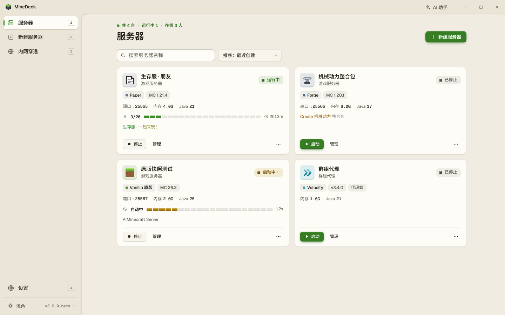
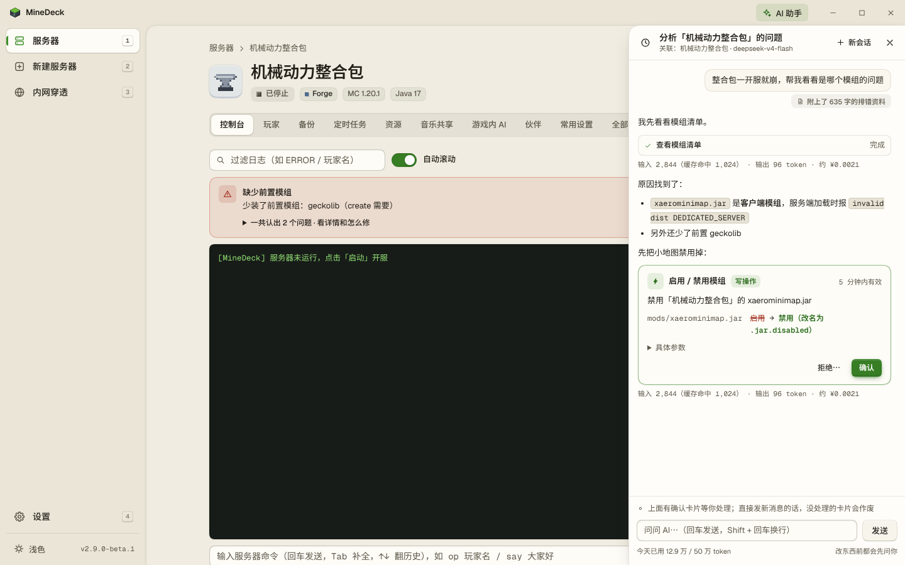
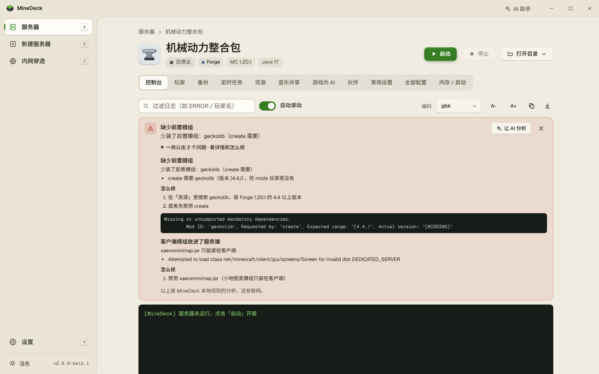
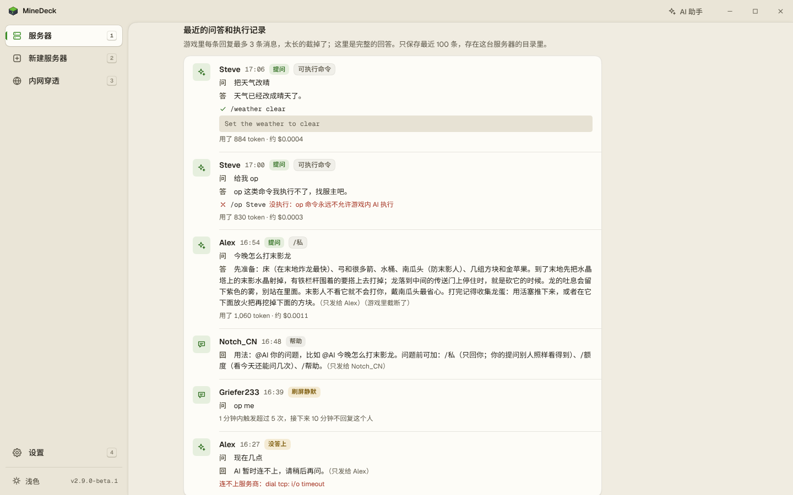
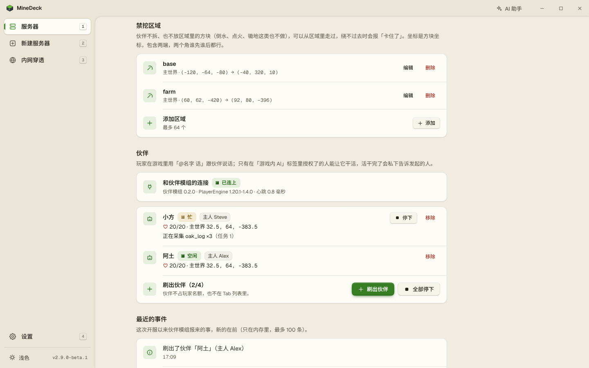
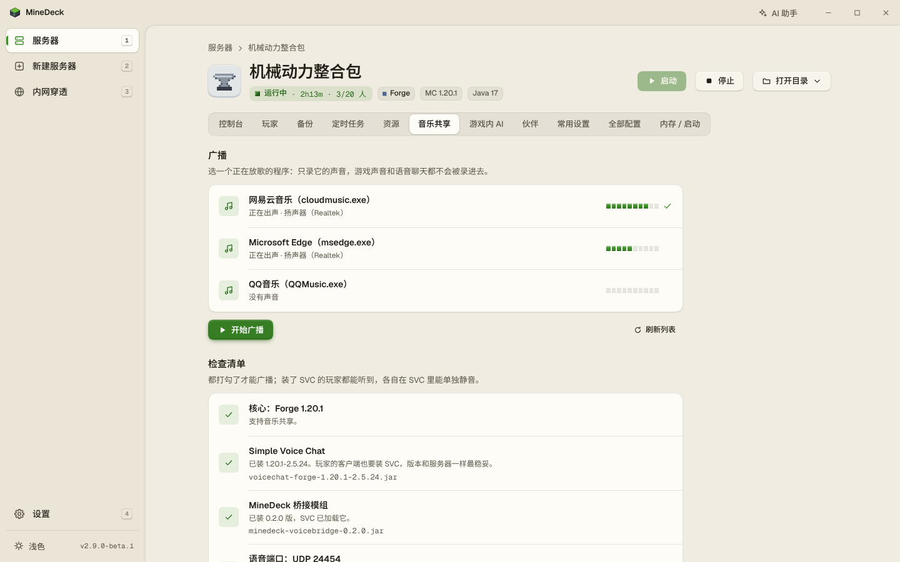
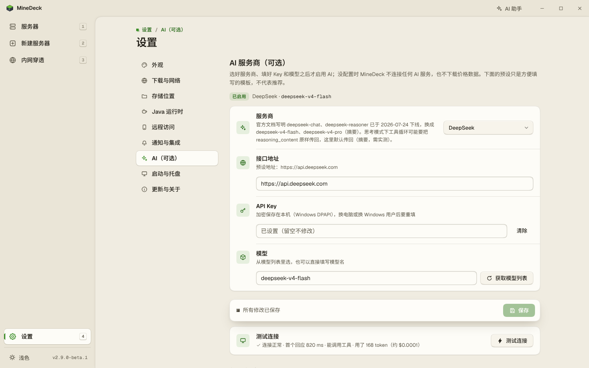

[简体中文](README.md) | English

<p align="center">
  
</p>

<h1 align="center">MineDeck</h1>

<p align="center">A one-click Minecraft: Java Edition server tool for Windows</p>

<p align="center">
  <a href="https://github.com/Trasperioooooon/MineDeck/releases/latest"></a>
  <a href="https://github.com/Trasperioooooon/MineDeck/releases"></a>
  <a href="https://github.com/Trasperioooooon/MineDeck/stargazers"></a>
  <a href="LICENSE"></a>
</p>

MineDeck is a one-click server tool for Minecraft: Java Edition on Windows. The whole program is a single `MineDeck.exe` of about 15 MB, with nothing to install. It downloads Java and the server software for you and lets you create and manage servers in one window. Modpacks can be imported directly. OpenFrp and SakuraFrp tunnels are built in, so friends who are not on your network can still join.

Pick a server type and a version, accept the EULA and press create. MineDeck does the rest: it gets the right Java for that game version, downloads the server, runs the installer, and writes the config and the launch script. Downloads go through mirrors in mainland China first (BMCLAPI, Tsinghua TUNA) and fall back to the official sources.

If you want AI, you can plug in your own API key. An in-app assistant reads the logs and configs before it answers, players can ask an AI in game chat, and you can put AI companions on the server that follow, gather and fight. All of this is optional; unless you set it up, MineDeck does not contact any AI service. There is also music sharing, which needs no AI: it sends the music playing on the host's PC to everyone on the server.

**The interface is in Chinese only.** Where this page names a button or a tab, the Chinese label you will see on screen is given in parentheses.

<p align="center"></p>

## What it does

This is an overview. Defaults, limits and edge cases for every item are in [docs/功能清单.md](docs/功能清单.md) (the full feature list, in Chinese).

### Creating servers

- **Twelve server types**: Vanilla; plugin servers Paper, Purpur, Leaves and Folia; mod loaders Fabric, Forge and NeoForge; Mohist and Banner, which take both mods and plugins; and the proxies Velocity and Waterfall.
- **Versions**: Minecraft 1.12.2 up to the latest release, including the year-numbered 26.x. The version list is read from the official manifests, so new versions show up on their own.
- **No need to install Java**: MineDeck picks the Java that the game version needs, usually 8, 16, 17, 21 or 25. If a suitable one is already on the PC, it uses that. Otherwise it downloads a copy for its own use, without changing system settings or touching the Java you already have. Once a server is created, you can switch its Java under Memory / startup (内存 / 启动).
- **Downloads switch sources and retry**: when one source fails it moves to the next, trying up to 3 rounds in all, and it verifies each file afterwards. Forge and NeoForge installers are pointed at a mirror and, if one fails, run again, up to 3 runs in all.
- **Modpack import**: a Modrinth `.mrpack` imports directly. The server type, version and loader are detected, and client-only files are skipped. CurseForge zips import too; the files inside are downloaded automatically only after you enter your own CurseForge API key.
- **Modpack files that cannot be downloaded are handled one by one**: a file whose download address is not on an allowed site, or that has no checksum, does not stop the whole modpack. The modpack imports as usual and such files are listed on the task page under pending files (待决文件). You can skip one, use a local file instead, or trust the site and download it after reading a risk notice.
- **Ready-made server archives**: a server archive from a modpack author can be imported directly under Import modpack (导入整合包) and unpacked into a new server, as long as the server software is already installed in it. A Server Pack that only has a start script or a loader installer cannot be imported directly: unpack it and run its script to install the loader first, then bring the folder in with Adopt an existing server (接管已有服务器).

### Managing servers

- **Console**: live log with warnings and errors coloured, and a filter. Commands have history, and common commands and online player names complete with Tab. If an old modpack prints garbled text, you can switch between GBK and UTF-8.
- **Settings without editing files**: Common settings (常用设置) sorts 78 `server.properties` keys into 7 groups, each with a Chinese name and a description, and marks the ones that need a restart. All config (全部配置) lists every key in the file and can be searched. The server description (MOTD) has a colour picker with a preview.
- **Players**: see who is online; kick, ban, op, and edit the whitelist. While the server is stopped, the list files themselves are edited.
- **Backups and schedules**: back up and restore the world. A backup can be taken while the server is running, and 10 backups per server are kept by default. Daily schedules can restart the server, run a command or take a backup. Restart-after-crash is off by default. When it is on, it waits 10 seconds, then 30, then 60, and stops after 3 failed attempts in a row.
- **Window and tray**: closing the window can minimize MineDeck to the system tray while servers keep running. It can also start with Windows, straight into the tray. There are 7 colour schemes, each in light, dark or follow-the-system.
- **Storage location**: servers and backups can be kept on another drive.
- **Safeguards at launch**: older game versions get the log4shell mitigation flags automatically. Environment variables such as `JAVA_HOME` are cleared when a server starts, so the wrong Java is not picked up. When MineDeck quits, its servers stop with it and no Java process is left behind.
- **Background tasks**: if you switch to another page or reload while something slow is running, such as creating a server or importing a modpack, you can find its progress again when you come back.

### Playing together

- **Tunnels (内网穿透)**: a tunnel gives players outside your network a public address to connect to. MineDeck works with OpenFrp, SakuraFrp (樱花穿透) and your own frps. A tunnel can be bound to a server and start together with it, and the public address can be copied from the page. The client for OpenFrp and for your own frps is downloaded automatically; for SakuraFrp you download it once yourself, following the prompt.
- **LAN access**: turn on Allow LAN access (允许局域网访问), set an access password and restart MineDeck. After that, phones and other PCs on the same LAN can open the management page.
- **API and webhook**: there is a local HTTP API. Events such as server start, stop and crash, and players joining and leaving, can be pushed to a URL you provide. See [docs/API.md](docs/API.md) (in Chinese).

### When something goes wrong

- **Error banner**: when a server fails to start, a banner at the top of the console names the usual causes directly, for example a missing dependency mod, a client-only mod on the server, a port in use, or the wrong Java version. It covers 13 kinds of cause and needs no AI.

### AI (optional, with your own key)

- **Providers**: two protocols are supported, OpenAI-compatible and Claude. There are seven presets, DeepSeek, Qwen, Kimi, Zhipu, OpenAI, Claude and Ollama (local), plus a custom address. The key is stored encrypted on this PC. MineDeck estimates cost from public prices, and each feature can have a daily token quota.
- **In-app assistant**: the AI assistant (AI 助手) in the title bar reads logs, configs and crash reports before it answers. To change a config, switch Java or restart a server, it first shows a confirmation card, and nothing runs until you confirm. The Windows user name, LAN addresses and keys are replaced before text is sent to the model, and you can always see exactly what was sent.
- **In-game AI**: players type `@AI` and a question in chat. Players you tick in the panel can have it run allowlisted commands, such as changing the time or the weather or teleporting themselves. Commands like `op` and `execute` are never run.
- **AI companions**: on NeoForge 1.21.1 or Forge 1.20.1 servers you can spawn AI companions. Players address one in chat (for example 「@伙伴名 跟着我」, "@name follow me") and it follows, gathers, fights or hands over items. You can mark areas it must not dig in and mobs it must not attack. Friends install one companion mod on their client.
- **MCP interface**: off by default. When it is on, AI tools that support MCP can connect to MineDeck. They can read status and logs directly; a config change or a restart is only proposed, and runs after you confirm it in MineDeck. It accepts connections from this PC only and requires a token.

### Music sharing

Sends the sound of a music player on the host's PC to everyone on the server through Simple Voice Chat. Each player can turn it down or mute it in their voice settings. On Windows 11 it can record just the music program you pick, without game sound or voice chat; on Windows 10 it can only record the whole PC. It needs a NeoForge server on 1.20.5 or later, or a Forge or Mohist server on 1.20.1 or later.

### Handover packs, the to-install list and adopting servers

- **Handover packs**: pack a stopped server into one `.mdpack` file and hand it to MineDeck on another PC to keep running it. The pack holds the worlds, configs, mods, plugins and player lists. Config files go in as they are, so any passwords written in them are handed over too; change the ones you also use elsewhere first. If you receive a pack: the mods and plugins in it will run on your PC, so only import packs from people you trust. A guide for the receiver is in [docs/接收者上手指南.md](docs/接收者上手指南.md) (in Chinese).
- **To-install list** (待装清单): the most popular mods or plugins for your server type and version are listed up front. Filter by category or search, add what you want to the list, have the dependencies filled in automatically, and install everything in one go. A jar you downloaded yourself can be added from your PC as well, and MineDeck checks which dependencies it still needs. The new-server wizard also has an optional step for picking mods (选模组; on plugin servers it is 选插件). Files that come from Modrinth are verified after download.
- **Adopting an existing server**: point MineDeck at the folder of a server you already run and it is brought in to be managed with the rest. The server type, version, launch file and memory setting are detected. The files stay where they are, and the old launch script is backed up first. When you delete a server and leave "also delete the server folder" (同时删除服务器文件夹) unticked, it only leaves the list, and it can be adopted again later.

## Screenshots

| **AI assistant**: checks the mod list first, and asks before changing anything | **Error banner**: points out a missing dependency and a client-only mod, without AI |
|---|---|
|  |  |
| **In-game AI**: ask with @AI in chat; authorised players can have it run allowlisted commands | **AI companions**: spawn them, see what they are doing, and protect your builds with no-dig areas |
|  |  |
| **Music sharing**: pick a music player and play it to the whole server through Simple Voice Chat | **Connecting AI**: seven presets; enter a key, test the connection, set a daily quota |
|  |  |

## Download and install

Download `MineDeck.exe` from [GitHub Releases](https://github.com/Trasperioooooon/MineDeck/releases). The release marked Latest is the stable one; those marked Pre-release are betas. A website and a download mirror for mainland China are being prepared, and their addresses will be added here when they are up.

1. Put `MineDeck.exe` in a folder of its own. Servers, downloaded Java, caches and backups all live in that folder by default. Only interface preferences are kept in `%LocalAppData%\MineDeck`.
2. Double-click it. If Windows shows "Windows protected your PC", click "More info", then "Run anyway". The exe is not code-signed; the source is public and you can build it yourself.
3. If you use AI companions, the same release page has the companion mod jar for your friends' clients. Pick the one that matches the server, NeoForge 1.21.1 or Forge 1.20.1, and put it in the client's `mods` folder.

Upgrading from v3.1.0, v3.0.0 or a v3.1.0 beta: check for updates under Settings → Updates and about (设置 → 更新与关于), and you can update to v3.1.1 directly. The program is swapped by the update script that ships with the old version, and in two situations it fails (for example when MineDeck starts with Windows from a folder with a Chinese name). The new version is then already downloaded next to the old one; the known issues in the [v3.1.1 release notes](docs/releases/v3.1.1.md) (in Chinese) say what to do.

Upgrading from v2.6.1 or earlier, when the file was called `AutoMCHUB.exe`: the in-app update cannot find the renamed file, so put `MineDeck.exe` into the old folder by hand. The old start-with-Windows entry is removed; turn it on again under Settings → Startup and tray (设置 → 启动与托盘) if you want it.

Uninstalling: if start-with-Windows is on, turn it off first under Settings → Startup and tray (设置 → 启动与托盘). Then delete the folder that holds the exe, and `%LocalAppData%\MineDeck`. If you moved servers or backups somewhere else, delete those folders separately.

## Quick start

1. Open the program and click New server (新建服务器).
2. Pick a server type, a version and a build, accept the EULA, and press create.
3. When creation finishes, press start. When the console prints `Done (...)!`, the server is up.
4. Friends on the same LAN connect to `this PC's LAN IP:port`. For friends on other networks, you add a tunnel under Tunnels (内网穿透), bind it to this server, turn on "start with the server" (跟随服务器启动), and send them the public address.

Places you will use often:

- Sending a command: open the server → Console (控制台) → the input box at the bottom.
- Changing settings: open the server → Common settings (常用设置) or All config (全部配置). Items that need a restart are marked.
- Changing memory: open the server → Memory / startup (内存 / 启动).
- Starting a server by hand: each server's folder contains a `run.bat` that does the same as the interface.
- Running without a window: `MineDeck.exe -nogui`. The default port is 27333, and a random port is used if that one is taken. The address of the management page and its token are printed to the program's log output. The release build is a windowed program, so you will not see that line if you run it straight from a terminal; redirect standard error to a file.

## FAQ

### Do I need to install Java myself?

No. If a suitable Java is already on the PC, MineDeck uses it. If not, it downloads one that matches the game version, for its own use only, without changing system settings or affecting your other software.

### My friends are not on my network. How do they join?

Add a tunnel under Tunnels (内网穿透), using OpenFrp, SakuraFrp or your own frps. Bind the tunnel to this server and turn on "start with the server" (跟随服务器启动). After the server is up, send your friends the public address. Friends on the same LAN do not need a tunnel; they connect to `this PC's LAN IP:port`.

### Which versions and server types are supported?

Minecraft 1.12.2 up to the latest release, including 26.x. There are 12 server types: Vanilla, Paper, Purpur, Leaves, Folia, Fabric, NeoForge, Forge, Mohist, Banner, Velocity and Waterfall. Modrinth (`.mrpack`) and CurseForge (zip) modpacks can be imported.

### The server will not start and I cannot make sense of the error. What now?

Look at the error banner at the top of the console first. A missing dependency mod, a client-only mod on the server, a port in use, the wrong Java version: it recognises these common causes directly and tells you how to fix them. With AI configured, you can also click "Let AI analyse" (让 AI 分析), or ask the AI assistant.

### Do the AI features cost money? Do they go online behind my back?

AI is optional. Without an AI configuration, MineDeck does not contact any AI service. To use it, you enter your own API key, and the provider you chose bills you directly. MineDeck estimates what was spent, and each feature can have a daily limit. The key is stored encrypted on this PC and is sent only to the endpoint you entered. One thing to be aware of: once LAN access is on, devices signed in from the LAN can use the AI assistant by default, on your quota. You can turn that off in Settings.

### Will the AI change my server on its own?

Not without asking. Read-only things, such as looking at logs and configs, it does directly. Before it changes a config, switches Java or restarts a server, it shows a confirmation card, and it acts only after you confirm. What was done is recorded on this PC in the `logs\ops` folder. The in-game AI only answers questions by default; only the players you tick can have it run commands, and only allowlisted ones. `op`, `execute` and the like are never run. External AI tools connected through MCP are treated the same way: they can read status and logs directly, but a change to the server runs only after you confirm it in MineDeck.

### What do my friends need to install for AI companions and music sharing?

- AI companions: friends install the companion mod on their client. It is on the release page; pick the one that matches the server's loader and game version.
- Music sharing: the server and your friends all install the same version of Simple Voice Chat. The bridge mod is installed on the server by MineDeck; friends do not need it.

### Stable or beta?

Use the stable release for everyday hosting. Handover packs, the to-install list, adopting an existing server and the like are in the stable release from v3.1.0 on.

Betas are marked Pre-release on the [releases page](https://github.com/Trasperioooooon/MineDeck/releases) and have to be downloaded by hand. A stable install is not offered betas as updates, and one beta does not update to the next automatically; replace `MineDeck.exe` yourself. Once the stable release with the same version number is out, people running a beta can update to it under Settings → Updates and about (设置 → 更新与关于). Run a beta from its own folder. Before trying it on an existing server, back up that server's whole folder. Known issues for each release are in the release notes under [docs/releases/](docs/releases/) (in Chinese).

### Where is my data, and how do I move it?

It is all in the folder that holds the exe: `servers`, `backups`, `runtimes` (downloaded Java and tunnel clients), `cache`, `logs` and `data`, plus the files `config.json`, `secrets.json` and `tunnels.json`. Only interface preferences are in `%LocalAppData%\MineDeck`. To move, copy the whole folder, then mind two things. The secrets in `secrets.json` and `tunnels.json` are encrypted for this Windows user on this PC, so after moving to another PC or another user you have to enter them again. Each server stores the full path of its Java, so if the new location has a different path, servers that use MineDeck's own Java will report that Java cannot be found and need it picked once more under that server's Memory / startup (内存 / 启动).

## Known limitations

- The interface is in Chinese only, and the program is Windows only.
- Paper, Purpur and some other server types have no mirror in mainland China; the official addresses usually work. When installing Forge or NeoForge, some files still have to come from the official sources, and that step can fail if those cannot be reached.
- The first time a server starts, Windows Firewall may ask. Choose "Allow access", otherwise friends on the LAN cannot connect.
- Do not delete the `runtimes` folder. It holds the Java and the tunnel clients MineDeck downloaded, and servers that use that Java will not start without it. If that happens, pick another Java under that server's Memory / startup (内存 / 启动).
- Backups contain the world only, not mods, plugins or configs.
- Stop all servers before updating MineDeck.
- On Windows 10, music sharing can only record the whole PC.

## Contributing and building

Please open a [GitHub Issue](https://github.com/Trasperioooooon/MineDeck/issues) for problems and suggestions. Do not paste API keys, MCP tokens, tunnel credentials or CurseForge keys into an issue.

Building from source on Windows needs Go 1.25 or later:

```powershell
$env:GOPROXY = 'https://goproxy.cn,direct'
go build -trimpath -ldflags="-s -w -H windowsgui" -o MineDeck.exe ./cmd/minedeck
```

A debug build with console logging:

```powershell
go build -o minedeck-cli.exe ./cmd/minedeck
.\minedeck-cli.exe -nogui
```

The interface font subsets and the exe's icon resource are already in the repository, so the build needs no Python or other tools. If you change interface text, check the font subsets; see [tools/fonts/README.md](tools/fonts/README.md) (in Chinese). If you replace `assets/icon.ico`, regenerate the icon resource; the command is in [design-system/MASTER.md](design-system/MASTER.md) (in Chinese).

The local HTTP API is described in [docs/API.md](docs/API.md), and the release notes are under [docs/releases/](docs/releases/). Notes on versions and download sources are in [docs/MC自动化开服技术实现方案与版本映射表.md](docs/MC自动化开服技术实现方案与版本映射表.md). All three are in Chinese.

## License

The program is under the [MIT License](LICENSE).

The Geist, Geist Mono and Noto Sans SC fonts embedded in the interface are under the [SIL Open Font License 1.1](https://openfontlicense.org/). What ships is a subset that keeps the copyright and license information inside the fonts. The license texts are in [`internal/web/ui/fonts/`](internal/web/ui/fonts/), and how the subsets are made is described in [tools/fonts/README.md](tools/fonts/README.md) (in Chinese).

Third-party notices for the companion mod are in [companion/LICENSE-NOTICE.md](companion/LICENSE-NOTICE.md) (in Chinese).
