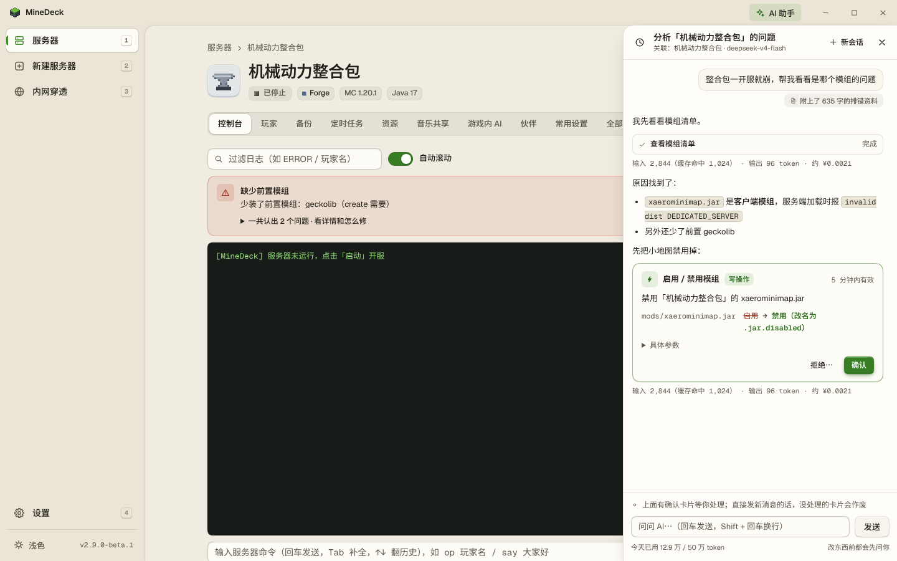

The **AI Assistant** sits at the top-right corner of the window title bar (once an [AI Provider](./ai-providers.md) is configured, you can drag the left edge of the right-hand drawer between `320px` and `720px` wide). Unlike a generic chatbot that guesses without context, it connects directly to MineDeck's local console and configuration layer to inspect running servers, diagnose crashes, and prepare concrete edits.

## Common Workflows {#capabilities}

1. **Follow up from an error banner (**「让 AI 分析」** / Ask AI to Analyze)**:
   When the console's top error banner highlights a problem—or when a log failure isn't covered by built-in rules—click **「让 AI 分析」** (Ask AI to Analyze). MineDeck first opens **「发给 AI 之前，先看一眼」** (Preview before sending to AI), where you can expand the diagnostic bundle. The data is scrubbed using rule-based redaction that replaces known secrets, program paths, user directories, and several fixed patterns; it is not guaranteed to catch every sensitive detail, so review it before sending. Once sent, **「实际发给 AI 的内容」** (What was actually sent to AI) becomes viewable in the conversation. Typing directly into the assistant and clicking **「发送」** (Send) skips this pre-send preview. See the [Console Error Banner Index](../troubleshooting/error-banner-index.md) for a full reference.
2. **Inspect status and configs in plain language**:
   Ask questions such as "Which servers are running right now?", "How much RAM is allocated to each server?", "Check recent errors in Tech World", or "Find a 1.21.1 Fabric performance optimization mod and add it to the install queue."
3. **Prepare configuration, Java, or mod changes**:
   Ask it to "Change max players to 12", "Switch my test server to Java 21", or "Disable that crashing client-only mod." After inspecting the state, the assistant presents a clear action proposal card waiting for your approval.

## Core Safety Model: Three Action Tiers and Confirmation Cards {#safety}

To enforce a strict boundary—**AI never modifies your server behind your back**—every MineDeck action is classified into three tiers:

- **Read-only actions (executed directly)**: Listing servers, reading logs, inspecting config files, and searching Modrinth. These need no confirmation modal; the assistant checks and replies immediately.
- **Write / risky actions (require your explicit click)**: Editing `server.properties`, changing Java or memory settings, disabling or deleting mods, installing queued mods/plugins, or starting/stopping/restarting a server. The assistant can only emit a **「等你确认」** (Pending confirmation) card specifying which server changes, what values are edited, and the expected impact. **Nothing changes unless you personally click Confirm**; ignoring or rejecting the card leaves everything untouched, and malformed proposals with invalid parameters fail immediately without leaving blank cards behind.
- **Human-only high-risk actions (completely inaccessible to AI)**: Selecting local drive folders, adding local `.jar` files from your PC to the queue, **replacing worlds and deleting restore points**, **Toolbox exports**, changing global storage folders, editing AI provider settings, or **starting a local Music Sharing broadcast** are hidden from both the AI Assistant and MCP tools and can only be triggered manually.

## LAN Management and the AI Assistant Toggle {#lan-access}

- By default, anyone signing in to the web console over [Phone & LAN Remote Management](../networking/remote-and-friends.md) **can also use the host's AI Assistant** (spending the host PC's configured quota and API balance).
- If you want LAN devices only to check logs or restart a server without spending your AI quota, open **「设置 → AI（可选）」** (Settings → AI (Optional)) and turn off **「局域网可用 AI 助手」** (Allow AI Assistant over LAN). The **AI Assistant** button then disappears from title bars on other devices.
- In addition, if you enable external tool integration, all write proposals submitted by external clients appear at the top of the **「AI 助手」** (AI Assistant) drawer awaiting your local confirmation. See [Connect External AI Clients via MCP](./mcp-setup.md).
