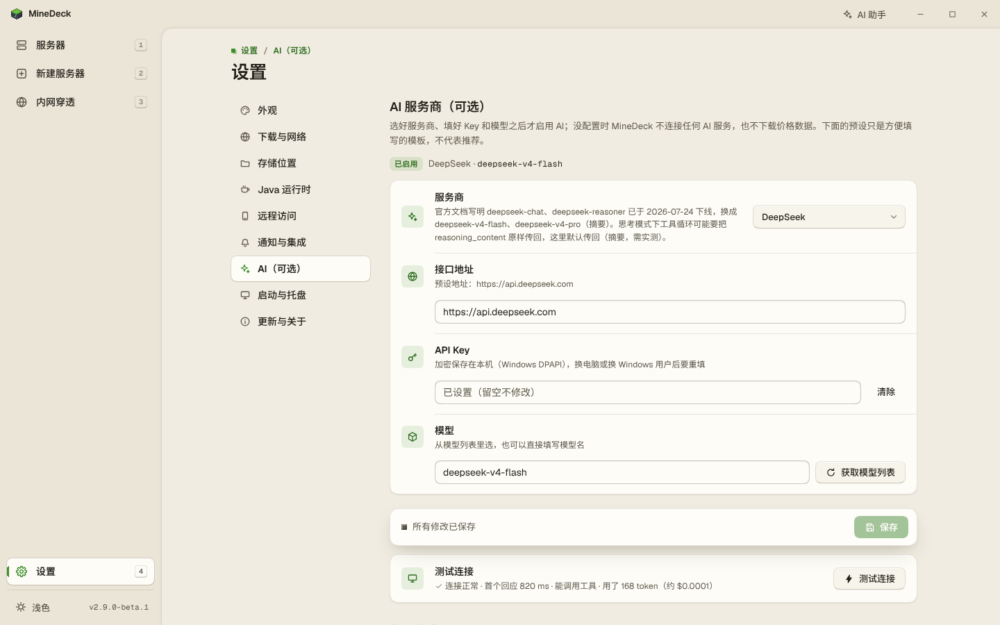

AI features in MineDeck are strictly optional: **until you configure a provider and API Key, MineDeck sends zero AI requests and does not even download the public pricing table**. Once configured and enabled, the **AI Assistant**, **In-Game AI**, and **AI Companions** share that provider and Key while tracking separate daily token quotas and limits.

## Built-In Presets and Custom / Relay Endpoints {#presets}

Open **「设置 → AI（可选）」** (Settings → AI (Optional)) from the sidebar (editing requires local desktop access; LAN remote views can inspect settings read-only but cannot change the Key):

| Preset | Default Protocol | Configuration Notes |
| --- | --- | --- |
| **DeepSeek** | OpenAI Compatible | Supports reasoning mode; during multi-turn tool calls MineDeck passes back reasoning content automatically to avoid upstream rejection (verify empty-reasoning compatibility with your real Key if needed) |
| **Qwen / Alibaba Cloud Model Studio (**通义千问**)** | OpenAI Compatible | Defaults to the Beijing region, with a quick toggle for Singapore; Keys are bound to their respective region |
| **Kimi (Moonshot AI)** | OpenAI Compatible | Mainland China (`moonshot.cn`) and international (`moonshot.ai`) Keys are not interchangeable |
| **Zhipu (**智谱**)** | OpenAI Compatible | Keeps the default trailing slash URL; automatically passes back reasoning fields when reasoning or Coding Plan endpoints are active |
| **Xiaomi MiMo (**小米 MiMo**)** | OpenAI / switchable to Claude | **Pay-as-you-go Keys (`sk-` prefix) only work with `api.xiaomimimo.com`; Token Plan Keys (`tp-` / `ttp-` prefix) only work with `token-plan-*` endpoints**—mixing them causes provider rejection; Token Plan has no `/models` endpoint, so type a model ID manually or choose from preset suggestions |
| **OpenAI** | OpenAI Compatible | Follows the system `HTTPS_PROXY` environment variable if a proxy is required |
| **Ollama (Local)** | OpenAI Compatible | Defaults to `http://localhost:11434/v1/` with **no API Key required**; prompts and logs stay on your PC and cost calculation is disabled |
| **Claude** | Claude Messages | Supports optional reasoning effort/depth; requires direct or proxied connectivity |
| **Custom (**自定义**)** | OpenAI / Claude | Connects to any compatible self-hosted server or relay endpoint with optional auth header and reasoning pass-back mode (**note that relay operators can see all prompt contents and your API Key**) |

## Setup Steps and Domain-Switch Protection {#setup}

1. Choose a **Provider** (**服务商**) and confirm the **Endpoint URL** (**接口地址**) (use the quick region switch button when available).
2. Enter your **API Key** (not needed for Ollama).
3. Expand the model selector or click **「刷新」** (Refresh) to fetch available models from the endpoint, or type an exact model ID manually.
4. Click **「保存」** (Save), then click **「测试连接」** (Test Connection) to verify the response.

> [!NOTE]
> **Key Encryption and Automatic Clear on Domain Change**
> - Keys are encrypted via Windows DPAPI and stored in `secrets.json` inside the app folder; they are never sent back to the browser UI or written to operation logs. Moving to another PC or Windows user account requires re-entering the Key.
> - **Leak prevention**: Switching paths or protocols under **the same website domain** preserves your stored Key; switching to **a different provider or website domain** warns you on save and **clears the previously saved Key**, preventing Provider A's Key from accidentally being sent to Provider B.

## Daily Quotas and Cost Estimates {#quota-cost}

- **Per-feature daily caps**: Under **「每日额度」** (Daily Quotas), set separate daily caps in units of `10,000 tokens` (`万 token`, summing input + output + cached tokens) for **「AI 助手」** (AI Assistant), **「游戏内 AI」** (In-Game AI), and **「AI 伙伴」** (AI Companions). Enter `0` or leave blank for unlimited; once exhausted, that feature pauses until `0:00` the next day.
- **Cost estimates**: Whenever a paid provider is configured, MineDeck refreshes unit prices every 7 days from the public pricing list (via mirror) and tracks estimates separately in CNY (`¥`) and USD (`$`) without automatic currency conversion. For unlisted models, add a **「自填单价」** (Custom Unit Price) row below (takes precedence over the public table; nothing is fetched when no paid provider is active or when using Ollama).

## Privacy and Pre-Send Redaction Preview {#privacy}

When the AI Assistant reads server logs or configuration files, outgoing text passes through rule-based redaction that masks known secrets, app directories, user directories, and several fixed patterns—it does not guarantee masking every sensitive detail, so inspect it yourself before sending. Player usernames are kept intact so diagnostics can still identify who failed to join.

Typing in the assistant chat box and clicking **「发送」** (Send) submits immediately with no preview step. Clicking **「让 AI 分析」** (Ask AI to Analyze) on an error banner opens **「发给 AI 之前，先看一眼」** (Preview before sending to AI), where you can expand **「展开查看要发送的排错资料」** (Expand diagnostic bundle to send). After sending, you can also review **「实际发给 AI 的内容」** (What was actually sent to AI) in the chat thread.

To turn AI off completely, click **「停用」** (Disable) at the bottom of the page. Disabling clears only the provider and Key while keeping usage counters and custom unit prices intact.
