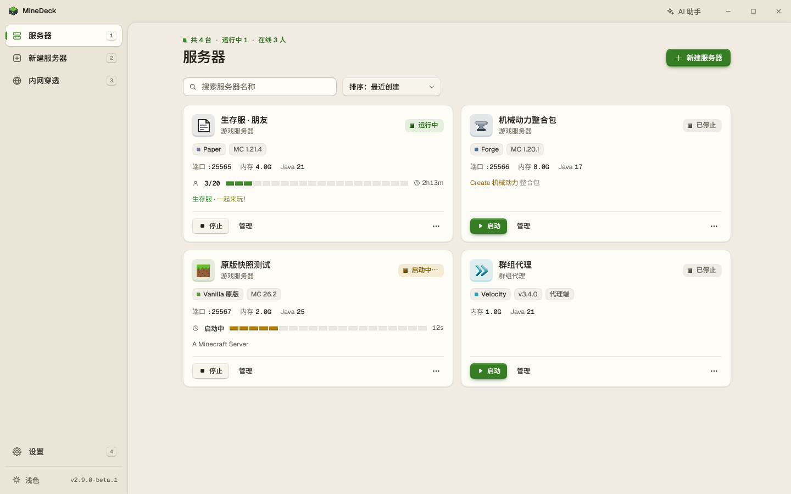

Double-clicking `MineDeck.exe` opens a desktop WebView2 window (or your default browser if WebView2 is unavailable). Here is how the workspace is organized—with exact Chinese labels as shown in the UI.

## First-launch onboarding & disclaimer {#onboarding}

The first time MineDeck runs, an onboarding card asks you to accept the Terms & Disclaimer. Once accepted, future launches go straight into the workspace. If you have no servers yet, the home view offers a direct button to launch the **Create server** wizard.

## Sidebar navigation & keyboard shortcuts {#sidebar}

Press number keys `1`–`5` (when not typing in a text box) to jump between the five main sections:

| Key | Sidebar tab (Chinese UI) | Purpose |
| --- | --- | --- |
| `1` | **「服务器」** (Servers) | View statuses, start/stop instances, copy LAN join addresses, inspect active background tasks |
| `2` | **「新建服务器」** (New Server) | Five workflows: Create from scratch, Import modpack, Create from world map, Import `.mdpack`, Adopt existing folder |
| `3` | **「内网穿透」** (Tunnels) | Add custom `frps` tunnels or connect OpenFrp / SakuraFrp accounts |
| `4` | **「工具箱」** (Toolbox) | Generate offline skin resource packs or export Modrinth `.mrpack` packages without touching existing servers |
| `5` | **「设置」** (Settings) | Global theme, download mirrors, storage folders, Java runtimes, LAN mobile admin, webhooks, AI & MCP, startup/updates |

The bottom footer of the sidebar includes a quick **Light / Dark** toggle, a **Quit MineDeck** button (**「退出 MineDeck」** — saves running worlds and stops servers/tunnels before closing), and the installed app version.

## Server detail view (up to 7 tabs) {#instance-tabs}

Selecting any server card opens its detail view. The header displays the core, version, status, one-click copyable **LAN join address**, **Start / Stop / Restart / Open folder** controls, and a **`···`** menu (switch LAN adapter IP, export `.mdpack` handover, remove from list, or delete). Directly beneath sits a persistent notice bar for startup failures, missing Java paths, higher-Java mod hints, or unresolved modpack files.

Tabs dynamically match the server core:

1. **「控制台」** (Console): Live SSE console stream with UTF-8 / GBK toggle, filtering, command history, Tab completion, and automatic 14-rule error banners.
2. **「玩家」** (Players): Online players, whitelist toggle & list, OPs, kicks (while running), and bans (omitted on proxies).
3. **「世界与备份」** (World & Backups): **「备份」** (manual backups & restores) and **「换地图」** (safe map replacement with multi-step restore points; omitted on proxies).
4. **「插件」 / 「模组」 / 「插件和模组」** (Addons): Top list toggles/deletes installed jars; bottom half browses Modrinth, uploads local `.jar` files, and resolves dependencies in **待装清单** (Install list; omitted on Vanilla).
5. **「定时任务」** (Schedules): Daily `HH:MM` restarts/commands/backups plus crash auto-restart toggles.
6. **「设置」** (Instance Settings): **「常用」** (78 common `server.properties` fields across 7 groups), **「启动与内存」** (RAM & Java), and **「全部配置」** (proxies only show Launch & Memory).
7. **「扩展」** (Extensions): Appears when supported by core/version, housing **「游戏内 AI」**, **「AI 伙伴」**, and **「音乐共享」**.

## Titlebar AI assistant & custom styling {#appearance}

- Click **「AI 助手」** on the top-right titlebar whenever you want log diagnostics or chat-driven configuration proposals (with resizable width from `320px` to `720px`). When external MCP tools queue write proposals, an indicator dot highlights this button.
- Under Settings → Appearance (**「设置 → 外观」**), each device remembers its own Light / Dark / System mode, **7 color schemes** (Block default, Fluent, GitHub, Graphite, Nord, Catppuccin, Solarized), and **8 accent colors**.
- Drop custom background image files into a `bg\` folder next to `MineDeck.exe` to use them as the interface backdrop.

> [!TIP]
> Links to GitHub, EULA, and Modrinth opened inside the WebView2 desktop window automatically hand off to your system default browser so existing logins and password managers work normally.
