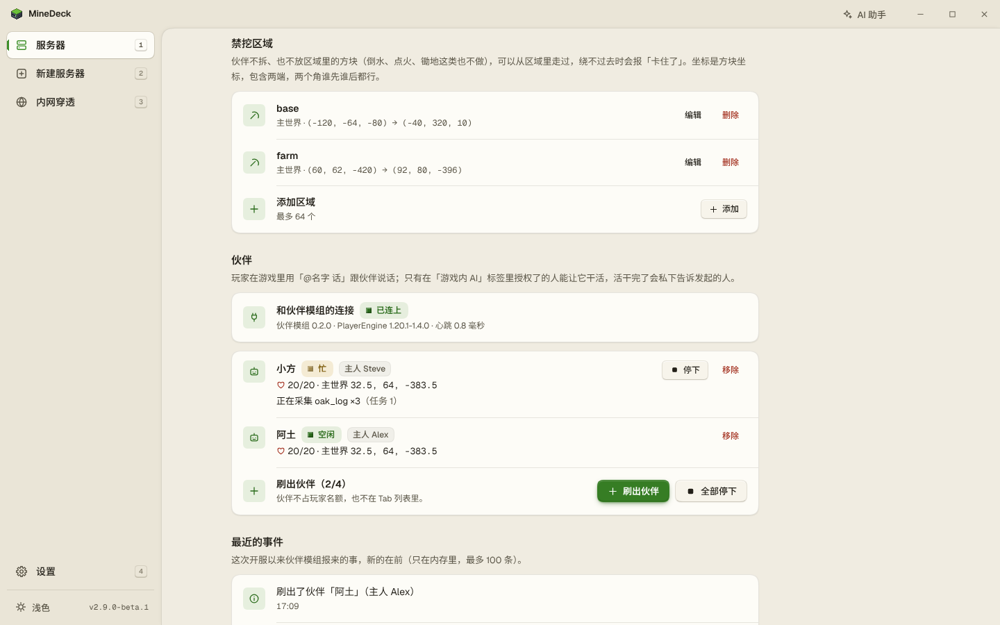

With **AI Companions** (**AI 伙伴**) enabled, lifelike companion entities appear inside your Minecraft world (without taking player slots or appearing in the Tab list) and persist in the world save. Chat directly with `@CompanionName <instruction>` so MineDeck's configured AI model understands your intent and dispatches in-game actions—everything runs on the host PC, and the companion mod never connects to third-party game accounts.

> [!NOTE]
> **Supported Loaders and Testing Status**
> - Currently supports **only `NeoForge 1.21.1`** (requires NeoForge `21.1.x`) and **`Forge 1.20.1`** (requires Forge `47.x`), bundled with companion mod version **`0.2.1`**. Other loaders and game versions will not enable or show as unsupported under **「扩展」** (Extensions).
> - In the UI top bar and subheadings, the page currently keeps the label 「伙伴」 and toggle **「打开伙伴」** (Enable Companion), located under **「扩展 → AI 伙伴」** (Extensions → AI Companions) on the server details page.
> - **Testing note**: Core mechanics pass in development/test environments, while **multi-player real-client sessions (including unauthorized-command blocking) still need broader real-world Windows testing**. Try it in a test world before adding it to a long-running survival save.

## Prerequisites and Server-Side Installation {#install}

1. **Configure Global AI and In-Game Player Authorization**:
   - Configure an AI provider and Key under **「设置 → AI（可选）」** (Settings → AI (Optional)).
   - Open the server's **「扩展 → 游戏内 AI」** (Extensions → In-Game AI) tab and check player names under **「能让 AI 执行命令的玩家」** (Players allowed to run AI commands)—**only authorized players can command companions**, while other players are politely asked to request permission from the host.
2. **Install the 3 Required Server Mods**:
   Open **「扩展 → AI 伙伴」** (shown as 「伙伴」 in earlier screenshots), check the top **「安装」** (Install) bar for missing components, and click **「安装」** (Install):
   - **Companion Mod** (e.g. `minedeck-companion-neoforge-1.21.1-0.2.1.jar`): Extracted directly from MineDeck into `mods\`.
   - **PlayerEngine** (e.g. `1.21.1-1.4.0` / `1.20.1-1.4.0`) and **Architectury API**: Downloaded automatically from Modrinth within tested compatible version ranges (avoiding untested breaking updates); restart the server once installed.

## What Friends Need on Their Client {#client-install}

> [!IMPORTANT]
> **Friends only need the single Companion Mod `.jar`—they do NOT need PlayerEngine or Architectury API.**
> - Download the companion `.jar` matching your server loader (`neoforge-1.21.1` or `forge-1.20.1`) and exact mod version from the [Download](/download/) page (expand included mod files) or the matching GitHub Release page (replace any older `0.2.0` jar if present), and place it into `.minecraft\mods\` (or the instance's `mods\` folder if using version isolation).
> - **If your server runs a modpack or extra content mods**, friends must still install that matching modpack and all required server/client mods.
> - If a friend joins without the companion mod installed, the server rejects the handshake with a clear Chinese prompt stating the exact `.jar` filename needed.

## Managing and Summoning Companions {#manage}

After restarting the server, switch on **「打开伙伴」** (Enable Companion), wait for the connection status to turn **「已连上」** (Connected), and then spawn companions. When this toggle is off, the backend state stays fixed at `off` and the UI displays **「没打开」** (Disabled). Stopping the server or closing MineDeck leaves companion entities and inventory stored in the save so they reconnect next launch.

- **Companion cap**: Defaults to **4** concurrent companions, configurable from **1 to 16**.
- **Spawn and remove**: Click spawn in the companion list, enter a **Companion Name** (`1–16` characters without spaces, `@`, `/`, `、`, or `:` so `@name` chat parsing stays unambiguous) and the owner's player name. Remove companions or halt active tasks from the same list anytime.
- **Protected mobs and no-dig zones**:
  - Uses a conservative built-in exclusion list by default (preventing accidental attacks on villagers, cats, and tamed pets) unless customized.
  - Define rectangular **no-dig zones** (**禁挖区域**) by coordinates per dimension (Overworld / Nether / End); companions can walk through protected zones without breaking blocks, placing blocks, or dumping buckets.

## Commanding Companions in Game Chat {#commands}

Authorized players simply type **`@CompanionName <instruction>`** in game chat (for example, `@小方 跟着我`):

- **Follow**: `@小方 跟着我` or follow a named player.
- **Gather**: `@小方 砍 10 个橡木原木` or mine ores and common blocks (automatically skips no-dig zones).
- **Navigate**: `@小方 去 120 64 -80`.
- **Combat / Guard**: `@小方 打旁边的僵尸` (respects protected-mob exclusions).
- **Drop items**: `@小方 把身上的原木都给我` (reports the actual quantity handed over privately).
- **Stop / Chat / Status**: Idle companions float automatically in water so they do not drown; completed tasks or stuck paths are whispered privately only to the player who issued the order.

> [!TIP]
> Under **「扩展 → 游戏内 AI」**, the per-player cooldown (default `8s`) and server-wide daily call cap (default `300`) are shared with `@AI` questions, while companion calls also track a separate per-player limit of `60` calls per day—adjust these thresholds there if needed.
