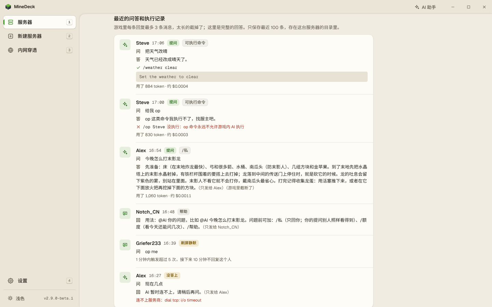

On any non-proxy server (**Velocity and Waterfall have no in-game chat and exclude this tab**), once you configure a global AI provider under **「设置 → AI（可选）」** and enable **「扩展 → 游戏内 AI」** (Extensions → In-Game AI) on a server, players can ask AI questions or trigger controlled in-game commands straight from Minecraft chat.

> [!NOTE]
> When In-Game AI is enabled, **MineDeck posts a one-time notice in game chat the first time someone asks AI after each server startup**, announcing which AI provider processes prompts so players know where their messages go. In addition, `/私` cross-account isolation and the latest server releases such as `MC 1.21.5+` are still undergoing broader live-server verification.

## Chat Prefix and Built-In Options {#usage}

The default prefix is **`@AI`** (case-insensitive, and also matches full-width `＠AI` from CJK or mobile keyboards). You can customize the prefix and add aliases (such as `@小助手`) in the panel.

Players simply type in game chat:

| Example | Behavior |
| --- | --- |
| `@AI 今晚怎么打末影龙` | Default reply **broadcasts publicly** (`[AI→Player]` style; long replies automatically wrap across up to 3 chat messages) |
| `@AI /私 这把附魔选哪个` | Sends the AI answer **via private `/tell` only to the asker** (note: your original prompt message still appears in normal chat) |
| `@AI /问 /time set day` | Answers in text only **without executing** any command (even for authorized players; unauthorized players do not see this hint in `/帮助`) |
| `@AI /额度` | Shows your remaining daily calls (**does not call the model or consume quota**) |
| `@AI /帮助` | Lists currently enabled capabilities and allowed commands on this server (also free of charge and quota) |

## Security Boundary: Authorized Players and Command Templates {#permissions}

MineDeck uses a **two-layer lock** so hosts can grant convenience without risking destructive commands:

1. **Player Allowlist (**「能让 AI 执行命令的玩家」**)**: Manually add and check exact player usernames. **Unchecked players can only chat/ask questions and can never trigger server commands**; this list also gates who can summon or command [AI Companions](./companion-mod.md). (Note: when `online-mode` is disabled, another user could spoof an offline username—the UI displays an offline/whitelist warning accordingly.)
2. **Command Templates (**「命令模板」**)**: Toggle safe command categories individually; every generated command must pass strict argument validation before reaching the console:
   - **Enabled by default**: time changes, weather changes, teleport self, self status effects, set own spawnpoint, locate structure/biome, `list`.
   - **Disabled by default**: switch own gamemode, give self items, change world difficulty, reveal world seed.
   - **Permanently forbidden (no toggle)**: `op`, `deop`, `ban`, `stop`, `execute`, and similar high-privilege or arbitrary-execution commands are always blocked.

## Anti-Spam Cooldowns, Rate Limits, and Daily Token Cap {#rate-limits}

Default limits (`0` disables a limit):

| Dimension | Default | Notes |
| --- | --- | --- |
| **Per-player cooldown** | `8s` | Shared cooldown between `@AI` questions and companion calls |
| **Per-player daily cap** | `60 calls` | Daily Q&A cap per player (`60` companion calls tracked separately) |
| **Server-wide daily cap** | `300 calls` | Combined daily total across all players for Q&A and companions |
| **Server-wide daily tokens** | `500,000 tokens` (`50 万 token`) | Total daily input + output token ceiling |
| **Anti-spam mute** | `> 5 accepted triggers in 1 min → 3-min mute` | Whispers remaining cooldown seconds to the player; calls already rejected by cooldown/quota do not count toward those 5 |
| **Concurrency & queue** | `1 active, up to 3 queued` | Prevents concurrent requests from stalling the server or spiking token cost |

> [!TIP]
> If chat-formatting plugins add prefixes (like `[VIP]`) before player names so default parsing misses chat lines, scroll to the bottom of **「扩展 → 游戏内 AI」** to use **「识别测试」** (Pattern Tester) and advanced rules: paste a raw console log line and test `原版 / Fabric` (Vanilla/Fabric), `Paper / Purpur`, `Forge / NeoForge`, or a `自定义正则` (Custom Regex) without touching live chat or saving until ready.
