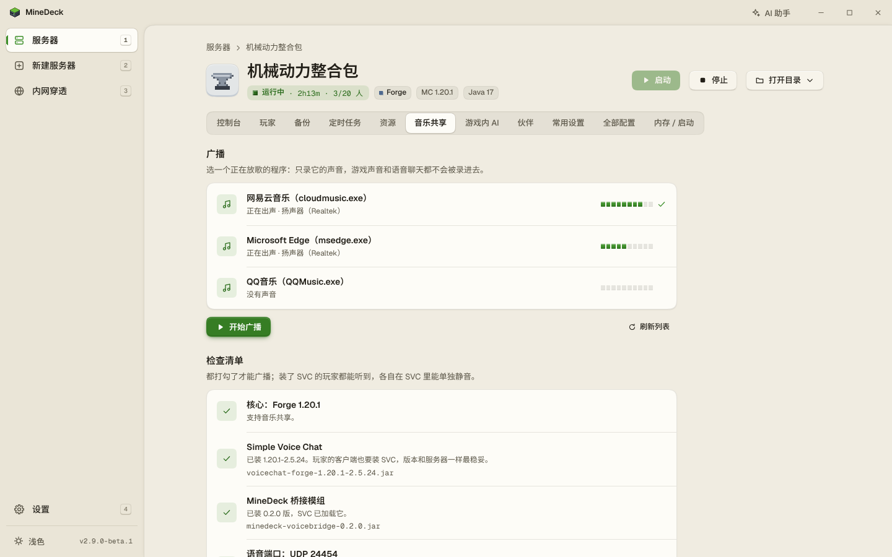

**Music Sharing** (**音乐共享**) captures audio from a music player on your host PC in real time, sends it locally to the `minedeck-voicebridge` server mod, and broadcasts it through **Simple Voice Chat (SVC)** in clean stereo so everyone with SVC installed can hear it—and adjust or mute "MineDeck Music Sharing" independently in SVC's volume menu without muting teammates.

> [!NOTE]
> **Compatibility and Real-Machine Testing Note**
> - **Supported loaders & versions**: Currently **only `NeoForge 1.20.5+`, `Forge 1.20.1+`, and `Mohist 1.20.1+`** are supported. `Fabric` and `Taiyitist` (formerly Banner) have no bridge mod yet, so Music Sharing is hidden under **「扩展」** (Extensions) on those servers.
> - **Verification status**: Bridge protocol handling and server plugin logic pass automated tests in local virtual test environments, while **live multi-player client listening and OpenFrp UDP voice relay tests continue under active real-world verification**.
> - **One server at a time, host-only start**: Only one server can broadcast at once, and **「开始广播」** (Start Broadcast) can only be triggered from the local host desktop (hidden from phones and AI/MCP; LAN devices may stop an active broadcast).

## Step 1: Pass the Page Checklist {#checklist}

Open your server's **「扩展 → 音乐共享」** (Extensions → Music Sharing) tab and verify all items in **「检查清单」** (Checklist) turn green:

1. **Simple Voice Chat (SVC)**: Must be installed on the server—click install to fetch the matching loader/version build directly from Modrinth, then restart the server (**every friend who wants to listen must also install the same version of Simple Voice Chat**, though friends do NOT need MineDeck's bridge mod).
2. **Bridge Mod (`minedeck-voicebridge`)**: Bundled inside `MineDeck.exe` (currently `0.2.0`); click once to install into `mods\` (byte-verified via SHA-256), then restart. If an unusual mod environment misses annotation discovery, the UI also lets you switch to the alternate `javafml` variant jar.
3. **UDP Voice Port and Tunneling**: SVC uses its own UDP port:
   - On the same LAN, simply allow the UDP port through your firewall;
   - When playing over **FRP tunneling**, make sure to add **a dedicated UDP tunnel with the Voice (`语音`) purpose** under **「内网穿透」** (Tunnels)! When that voice tunnel starts, MineDeck automatically populates the public endpoint into SVC's `voice_host` config unless you already entered a custom override.

## Step 2: Pick Your Audio Source, Suppress Host Echo, and Broadcast {#broadcast}

- **Windows 11 (per-app loopback capture)**: Select a specific active audio app (such as NetEase Cloud Music, QQ Music, Spotify, or a browser tab) to capture only that app and its child processes; MineDeck automatically excludes Windows system sounds, MineDeck itself, and Minecraft processes.
- **Windows 10 (system-wide loopback fallback)**: Because Windows 10 lacks per-process audio loopback APIs, it captures **the entire PC mix**—meaning game audio and voice chat will also be re-captured (the UI asks for one-time acknowledgment before first broadcast).
- **Prevent hearing yourself twice (echo exclusion)**: If you play Minecraft on the same PC that is playing music, enter **「我在游戏里的名字」** (My In-Game Name—supports comma-separated names or UUIDs). Within `2 seconds`, without restarting, the bridge mod excludes your account from receiving the music stream while everyone else hears it normally.

> [!TIP]
> Silence lasting longer than `100 ms` between tracks trims packets smoothly without wasting bandwidth; stopping a server or closing MineDeck stops any active broadcast cleanly first so no capture helper process is left behind.
