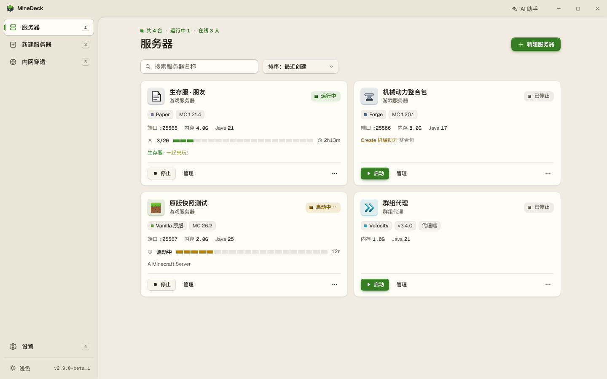

Click **「新建服务器」** (Create Server) in the sidebar to see all five creation modes (when your server list is empty, the primary button **「从零创建」** opens From Scratch directly, alongside text links for the other four):

| Mode | When to Use |
| --- | --- |
| **「从零创建」** (From Scratch) | Pick your own core and Minecraft version; MineDeck downloads Java and the server core automatically |
| **「导入整合包」** (Import Modpack) | Import Modrinth `.mrpack`, CurseForge `.zip`, or an author-built Server Pack archive |
| **「用已有地图开服」** (From Existing World) | Build a new server around a downloaded map or your singleplayer save |
| **「导入交接包」** (Import Handover Pack) | Restore an `.mdpack` handover archive exported by another MineDeck PC (`v3.1.0+`) |
| **「接管已有服务器」** (Adopt Existing Server) | Register an existing server folder already on disk without moving files (`v3.1.0+`) |

Below is the standard **From Scratch** walkthrough.

## Step 1: Choose a Server Core {#core}

Pick from all 12 supported cores spanning Minecraft `1.12.2` up to current `26.x` releases:

- **Vanilla**: `Vanilla 原版` — official Mojang server jar (no plugins or mods).
- **Plugin servers**: `Paper`, `Purpur`, `Leaves`, `Folia` — optimized Bukkit/Paper plugin ecosystems (`Folia` uses multithreaded regions and requires Folia-compatible plugins).
- **Modded servers**: `Fabric` (lightweight, fast boot), `NeoForge` (modern `1.20.2+` mod loader), `Forge` (classic mods and `1.20.1`/`1.12.2` favorites).
- **Hybrid servers**: `Mohist` (Forge + Plugins), `Taiyitist` (formerly Banner, Fabric + Plugins)—note both require **ASCII-only paths with no non-English characters**.
- **Proxies**: `Velocity` (fixed **Java 21**) and `Waterfall` (fixed **Java 17**) link multiple backend servers and hold no world save of their own.

## Step 2: Pick Minecraft Version, Build, and Java {#version}

- Select your **Minecraft Version** fetched from upstream metadata.
- Loader build numbers live under **「高级」** (Advanced)—most users can leave the recommended default build selected.
- **Java**: MineDeck automatically selects a compatible Java already installed on your PC, or downloads an isolated portable Java runtime (preferring mirrors in China) without touching system environment variables.

## Step 3: Basic Settings and EULA {#settings}

Name your server and confirm core runtime defaults:

- **Max Memory (`-Xmx`)**: Minimum `512 MB` in the creation wizard (`2048–4096 MB` suits vanilla or light plugin servers; `6144–8192 MB` suits heavy modpacks while leaving headroom for Windows and your client). Adopted servers inherit existing config values and start their slider at `1024 MB`.
- **Port**: Automatically skips ports claimed by other MineDeck servers or currently listening on the host (advancing sequentially from `25565`).

> [!NOTE]
> Windows Hyper-V, WSL, and Docker reserve OS TCP port ranges that pre-checks cannot detect during form entry. If first launch reports the port unusable, click **「改端口」** (Change Port) in the header or console banner to pick another port.

- **Online Mode & Whitelist**: Online verification (`online-mode`) defaults to off. The whitelist switch reads **「只允许白名单里的玩家进入」** (Allow whitelisted players only), which also defaults to off so friends aren't accidentally locked out on first launch (shown on From Scratch, Import Modpack, and From Existing World; Handover Packs keep packed settings and Adopt Server only reads the existing setting). Although Minecraft `26.3+` servers default whitelist to enabled upstream, MineDeck explicitly writes the setting matching your wizard choice into `server.properties`. Once running, manage players anytime under **「玩家」**.
- **Accept Minecraft EULA**: Required before creating any non-proxy game server (proxies Velocity/Waterfall have no EULA).

## Optional Step: Pick Mods / Plugins {#modcart}

On non-Vanilla cores (like Paper, Fabric, NeoForge, or Forge), `v3.1.0+` adds an optional **Pick Mods / Pick Plugins** step:

- Browse top Modrinth items by downloads, filter categories, search by keyword, or click **「从电脑添加」** (Add from PC) to include local `.jar` files.
- Entries added to **「待装清单」** (Install Queue) automatically resolve dependencies and install right after server creation (client-only mods are filtered out).

You can skip this step anytime and manage mods/plugins later inside the server's **Mods / Plugins** tab.

## Launch and Connection Test {#launch}

1. Click **「开始创建」** (Start Creating) and monitor installer progress in background Tasks (navigating elsewhere won't cancel it, and safe stages support cancellation).
2. Open the server details (or click **「启动」** on the Servers card).
3. Switch to **「控制台」** (Console) and wait for a ready line like:

```text
Done (2.418s)! For help, type "help"
```

4. Share the header **Connect Address** (`LAN_IP:Port`) with friends on the same LAN, or configure [Tunnels and Platform Accounts](../networking/tunnels-and-accounts.md) for Internet play.



> [!TIP]
> If startup stops with a red or yellow alert banner, check the [Console Error Banner Index](../troubleshooting/error-banner-index.md) first before digging through full logs.
