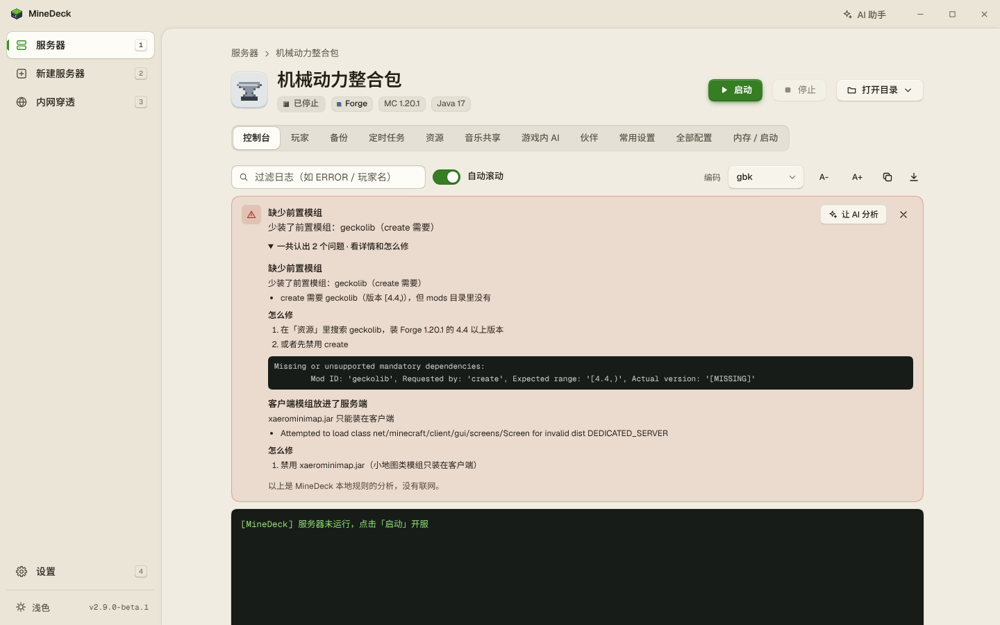

When a server fails to boot, crashes, or kicks a friend over mismatched mods, the Console tab displays a diagnostic banner automatically—no AI required. Under the hood there are 13 rule analyzers ("Wrong Java version" and "Unsupported JVM option" share one analyzer with two distinct outcomes, giving 14 rows below). Search this page using raw English keywords from your server log.

> [!TIP]
> With a global AI provider enabled, banners show **「让 AI 分析」** (Ask AI to Analyze). It collects a compact diagnostic bundle (~120 tail console lines trimmed by size, not the full file) and opens **「发给 AI 之前，先看一眼」** (Preview before sending to AI) where you can inspect **「展开查看要发送的排错资料」**; after sending, **「实际发给 AI 的内容」** stays visible in chat.
>
> **「复制报错信息」** (Copy Error Info) appears on header startup-failure alerts and generic error modals rather than the banner itself—use that or the [Feedback](/feedback/) page when sharing full raw errors.

## Quick Reference Table {#overview}

| Banner Title | Common English Log Keywords | Typical Fix Entry |
| --- | --- | --- |
| Missing Dependencies (**缺少前置模组**) | `MISSING` / `Missing or unsupported mandatory dependencies` | Server **Mods** tab / fetch library from Modrinth |
| Client Mod on Server (**客户端模组放进了服务端**) | `Attempted to load class ... for invalid dist DEDICATED_SERVER` | Server **Mods** → **Disable** (**停用**) |
| Wrong Loader (**装错加载器**) | `is a Fabric mod` / `Bukkit` / `Could not load '.jar'` / `plugin.yml` | Replace with matching loader build |
| Duplicate Mods (**重复模组**) | `Found duplicate mods` / `present in multiple files` | Keep newest version; Disable or Delete older copy |
| Incompatible Mods (**模组之间声明不兼容**) | `Incompatibilities between mods` / `is incompatible with` | Disable one of the conflicting mods |
| Mixin Conflict (**Mixin 冲突**) | `MixinApplyError` / `InvalidMixinException` / `MixinTransformerError` | Update affected mods or disable newly added overlapping mod |
| Wrong Java Version (**Java 版本不对**) | `UnsupportedClassVersionError` / `class file version` / `URLClassLoader` | **「设置 → 启动与内存」** → switch Java |
| Unsupported JVM Option (**JVM 参数不被支持**) | `Unrecognized VM option` / `Could not create the Java Virtual Machine` | **「设置 → 启动与内存」** → remove invalid flag |
| Port Busy (**端口被占**) | `FAILED TO BIND TO PORT` / `Address already in use` / `BindException` | Header **「改端口」** or close conflicting app |
| Out of Memory (**内存不够**) | `OutOfMemoryError` / `Could not reserve enough space for object heap` | **「设置 → 启动与内存」** → adjust heap |
| Frozen / Watchdog Kill (**卡死被看门狗关掉**) | `A single server tick took ... seconds` / `server will forcibly shutdown` | Inspect `Server thread` stack in crash report; update lagging mod or lower view distance |
| EULA Not Accepted (**没同意 EULA**) | `You need to agree to the EULA in order to run the server` | Read EULA and manually edit `eula.txt` |
| Client Mod Mismatch (**好友进不来**) | `Mod rejections` / `mismatched mod channel list` / `incompatible voice chat version` | Sync friend's client loader/mods/voicechat version |
| Broken Config File (**配置文件被改坏**) | `Failed loading config file` / `nightconfig.core.io.ParsingException` / `Invalid TOML` | Back up and delete malformed config to regenerate |

---

## 1. Missing Dependencies {#missing-deps}

- **Clue**: Missing required library mod or incompatible dependency version range.
- **Fix**:
  1. Read the listed missing mod ID(s) and dependents in the banner.
  2. Search and install that dependency from the server's **Mods** tab (or run a queue dependency check), or upgrade an outdated version.
  3. Share newly installed server mods/libraries with joining friends too.

## 2. Client-Only Mod on Server {#client-only}

- **Clue**: `Attempted to load class ... for invalid dist DEDICATED_SERVER`
- **Cause**: Client-side minimap, HUD, shader, audio, or UI mods dropped into server `mods/` (MineDeck whitelists the harmless `PlayerEngine` server probe warning used by AI Companions).
- **Fix**: Stop the server, find the mod in **Mods**, and click **「停用」** (Disable, renames to `.jar.disabled`)—friends keep it on their clients.

## 3. Wrong Loader {#wrong-loader}

- **Clue**: `File ... is a Fabric mod` / `for Minecraft Forge or an older version of NeoForge` / `plugin.yml not found` / `is a Bukkit or Bukkit-implementor`
- **Cause**: Mixing Fabric/Forge/NeoForge jars or putting mods into a Paper `plugins/` folder.
- **Fix**: Disable/delete the mismatched file and install the build targeting your exact server loader and MC version.

## 4. Duplicate Mods {#duplicate-mods}

- **Clue**: `Found duplicate mods`, `Mod ... is present in multiple files`
- **Cause**: Two copies or versions of the same mod ID left in `mods/`.
- **Fix**: Stop the server, keep the newer version, and **Disable** or **Delete** the older jar.

## 5. Declared Incompatible Mods {#incompatible-mods}

- **Clue**: `Incompatibilities between mods`, `Found incompatible mods`, `Mod A is incompatible with B`
- **Fix**: Keep one and disable the other in the **Mods** tab.

## 6. Mixin Conflict {#mixin}

- **Clue**: `MixinApplyError`, `InvalidInjectionException`, `InvalidMixinException`, `MixinTransformerError`, `FAILED during APPLY`
- **Cause**: Two mods patch the same game class or an outdated loader build misses an expected target.
- **Fix**: Update the mod and loader to recent builds for your MC version; if unresolved, disable recently added overlapping mods one by one.

## 7. Wrong Java Version {#java-version}

- **Clue**: `UnsupportedClassVersionError: ... class file version ... only recognizes class file versions up to ...`, `ClassLoaders$AppClassLoader cannot be cast to class java.net.URLClassLoader`, `Mod ... is missing a feature it requires to run`
- **Typical mapping**: `1.16.5` and older Forge require **Java 8**; `1.18–1.20.4` use **Java 17**; `1.20.5–1.21` use **Java 21**; `26.1+` use **Java 25** (some mods explicitly require newer Java than vanilla).
- **Fix**: Open **「设置 → 启动与内存」** and switch to or download the suggested Java version. If a portable runtime folder in `runtimes/` got corrupted mid-extract, delete that version folder and re-download.

## 8. Unsupported JVM Option {#jvm-option}

- **Clue**: `Unrecognized VM option '...'` / `Unrecognized option:` + `Could not create the Java Virtual Machine`
- **Cause**: Copying legacy GC flags (or typos) incompatible with the active Java version.
- **Fix**: Open **「设置 → 启动与内存」** and remove the flagged JVM argument, or switch Java versions.

## 9. Port Busy {#port-in-use}

- **Clue**: `**** FAILED TO BIND TO PORT`, `Address already in use`, `java.net.BindException`, `Unable to initialize query/rcon`
- **Cause**: Another running server, leftover process, or third-party app holds the port. If logs specify `Unable to initialize query` or `Unable to initialize rcon` / `RCON`, the Query or RCON port is busy rather than the player game port.
- **Fix**: Port change buttons appear in the **header startup-failure prompt** rather than the banner:
  - If another MineDeck server holds the port and an open suggestion is computed, the header offers **「改成 N 并启动」** (Switch to N and Start), saving `server-port` and launching—share the new port with friends.
  - Otherwise, click **「改端口」** (Change Port) to jump to `server-port` in **「设置 → 常用」** (or close the conflicting program).
  - For Query/RCON conflicts, update **「Query 端口」** (`query.port`) or **「RCON 端口」** (`rcon.port`) under Settings—even if the generic rule mentions `server-port`, follow whichever port (`query` vs `RCON`) the log names.

## 10. Out of Memory {#out-of-memory}

- **Clue**:
  - Fail to launch: `Could not reserve enough space for ... object heap`, `There is insufficient memory for the Java Runtime Environment to continue`, `Invalid maximum heap size`
  - Crash mid-run: `OutOfMemoryError: Java heap space` / `GC overhead limit exceeded` / `Metaspace`
- **Fix**:
  - Cannot allocate heap on launch: Lower Max Memory in **「设置 → 启动与内存」** (leave `1–2 GB` headroom below free system RAM) or close heavy background apps.
  - Runtime `Java heap space`: Raise Max Memory (large modpacks often need `6144–8192 MB`).
  - `Metaspace`: Remove restrictive `-XX:MaxMetaspaceSize` flags from JVM args and increase total memory slightly.

## 11. Frozen / Watchdog Shutdown {#watchdog}

- **Clue**: `A single server tick took ... seconds (should be max 0.05)`, `Considering it to be crashed, server will forcibly shutdown`
- **Cause**: A single server tick exceeded the watchdog timeout (default `60000` ms).
- **Fix**:
  - Check the `Server thread` stack inside `crash-reports/` to locate the lagging mod and update or disable it.
  - Reduce **View Distance** (`view-distance`) and **Simulation Distance** (`simulation-distance`) in **「设置 → 常用」**.
  - Only as a last resort, set `max-tick-time` to `-1` to disable watchdog kills (hung servers will then no longer auto-shutdown/restart).

## 12. EULA Not Accepted {#eula}

- **Clue**: `You need to agree to the EULA in order to run the server`
- **Fix**: Read the official Mojang EULA (`https://aka.ms/MinecraftEULA`), then **manually** edit `eula.txt` inside the server folder from `eula=false` to `eula=true` and restart (MineDeck and AI tools never accept the EULA on your behalf).

## 13. Client Mod Mismatch (Friends Cannot Join) {#client-mismatch}

- **Severity**: Warning (yellow; server keeps running while mismatched clients are kicked).
- **Clue**: `Channel of mod ... failed to connect`, `You are trying to connect to a server that is running Forge/NeoForge, but you are not`, `has incompatible voice chat version`, `Mod rejections`, `mismatched mod channel list`
- **Fix**:
  - Ensure friends launch the same loader (not Vanilla into Forge/NeoForge/Fabric) and exact same mods.
  - For `Simple Voice Chat` (`voicechat`), align protocol versions between client and server; if AI Companions are enabled, friends also need the Companion Mod jar.

## 14. Broken Config File {#broken-config}

- **Clue**: `Failed loading config file ...`, `nightconfig.core.io.ParsingException`, `Invalid TOML`
- **Cause**: Syntax mistake (missing quote, bracket, or `=`) from editing `.toml` / `.json` in `config/` or `serverconfig/`.
- **Fix**: Stop the server, back up the broken file, delete or reset it so the mod regenerates defaults on launch—or repair the syntax line indicated in the error log.
