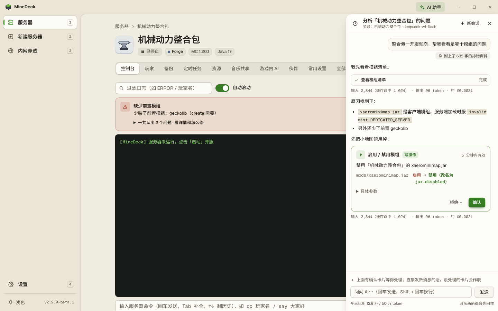

**AI 助手** 位于窗口标题栏右上角（配好 [AI 服务商](./ai-providers.md) 后即可使用，右侧抽屉边缘支持拖拽调宽到 `320px`～`720px`）。它不像泛聊天的通用机器人那样脱离实际状态瞎猜，而是直接挂在 MineDeck 本地控制台与配置层上，带着真实上下文帮你看服、找原因与出修改方案。

## 常见使用场景 {#capabilities}

1. 接力报错横幅（**「让 AI 分析」**）：
   控制台顶部的报错横幅已经指出问题，或者日志里的情况规则没覆盖到，可以点横幅上的 **「让 AI 分析」**。它会先打开 **「发给 AI 之前，先看一眼」**，里面能展开要发送的排错资料。这些资料按规则脱敏，只替换已知的密钥、程序目录、用户目录和几种固定格式，不保证抹掉所有敏感内容，发送前自己看一眼。发出去之后，对话里才看得到 **「实际发给 AI 的内容」**。直接在助手里打字再点 **「发送」** 则没有这一步预览。对照表见 [控制台报错横幅索引](../troubleshooting/error-banner-index.md)。
2. **用自然语言查状态与配置**：
   可以直接问例如「目前开着哪几台服？」「哪几台服内存给了多少」「查看一下《科技世界》最近的报错」「帮我找个 1.21.1 Fabric 的性能优化模组加入待装清单」。
3. **配合提出改配置 / 换 Java / 加模组操作**：
   让它「把最大人数改成 12」「把我的测试服换到 Java 21」「把刚才报错那个客户端模组停用」，助手查完后会列出一张清晰的操作提案卡片等你拍板。

## 关键安全机制：三类操作分级与「等你确认」 {#safety}

为了绝对保证「**AI 绝不会在你不知情时私自篡改服务器**」，MineDeck 对全站操作严格划分为三类：

- **只读操作（直接查询）**：查看服务器列表、读日志、读配置文件、搜 Modrinth。不需要弹框确认，助手查完立刻给你分析结论。
- **写入 / 危险操作（必须点确认才执行）**：修改 `server.properties`、换 Java 或内存、停用/删除模组、实际安装 **待装清单** 里的文件、启动/停止/重启服务器等。助手只能在对话里**先生成一张「等你确认」操作卡片**（清楚写出要改哪台、改什么值、影响是什么）；**只有你亲自点击确认按钮后程序才会执行**，你不点或点拒绝则什么都不会动。如果生成提案时就参数出错，不会留下一张空白空卡片。
- **「仅人工」高风险边界操作（AI 看得到但根本调不到）**：诸如选择本机盘符目录、添加电脑本地 jar 进待装清单、**换地图与删除恢复点**、**工具箱导出成品**、修改全局存储路径、更改 AI 设置或 **本机开始音乐共享广播** 等，界面与后端直接向 AI 隐藏入口，只能靠你自己动手。

## 局域网管理与 AI 助手开关 {#lan-access}

- 默认情况下，如果你在 [手机远程管理](../networking/remote-and-friends.md) 登录进网页控制台，**同样可以使用房主的 AI 助手**（消耗宿主电脑配置的额度与费用）。
- 如果你只想让局域网设备帮你看看日志重启服务器，不想让对方用你的 AI 额度——只需在全局 **「设置 → AI（可选）」** 中关掉 **「局域网可用 AI 助手」** 开关，关掉后其他设备标题栏将不再出现 **「AI 助手」** 入口。
- 此外，如果你还开启了外部工具接入，所有从外部客户端发过来的修改提案同样会集中汇总出现在 **「AI 助手」** 面板最顶部等你确认，详见 [MCP 接口接入外部 AI 客户端](./mcp-setup.md)。
