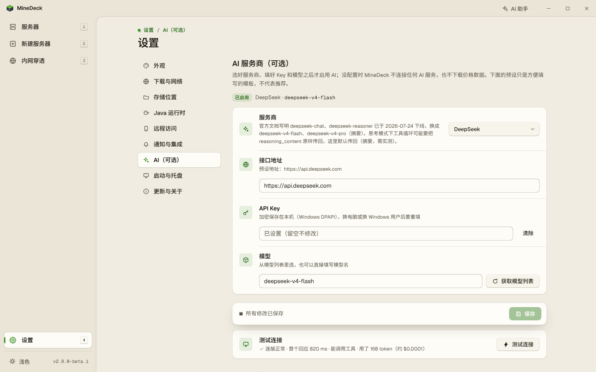

AI 是 MineDeck 的完全可选增强能力：**如果不填服务商和 API Key，MineDeck 不会主动请求任何 AI 接口，甚至也不会去下载公开价格表**。只有配置并启用后，**AI 助手**、**游戏内 AI** 与 **AI 伙伴** 这三项功能才会共用同一个配置和 Key，并分别单独统计每日 token 消耗与额度上限。

## 支持的服务商预设与自建 / 中转接口 {#presets}

打开左侧栏 **「设置 → AI（可选）」**（仅限坐在电脑本机上修改，手机远程页面只能查看设置不能改动 Key）：

| 预设名称 | 默认协议 | 填配置特别注意事项 |
| --- | --- | --- |
| **DeepSeek** | OpenAI 兼容 | 支持思考模式；多轮调用工具时程序会自动回传思考内容以避免服务端拒绝（思考空串兼容性建议填真实 Key 实测确认） |
| **通义千问（阿里云百炼）** | OpenAI 兼容 | 默认北京地域，页面也提供切换至新加坡可选地址；Key 与对应地域绑定 |
| **Kimi（月之暗面）** | OpenAI 兼容 | 国内站（`moonshot.cn`）与国际站（`moonshot.ai`）的 Key 不通用 |
| **智谱** | OpenAI 兼容 | 默认保留结尾斜杠地址；若开着思考/Coding Plan 地址，程序会自动按需回传思考字段 |
| **小米 MiMo** | OpenAI / 可切 Claude | **按量 Key（`sk-` 开头）只能配 `api.xiaomimimo.com`；Token Plan Key（`tp-` / `ttp-` 开头）只能配对应 `token-plan-*` 地址**，混用会被服务商拒绝；Token Plan 无 `/models` 列表可手填模型或从预设建议中选 |
| **OpenAI** | OpenAI 兼容 | 若当前网络需要代理，MineDeck 遵循系统环境变量 `HTTPS_PROXY` |
| **Ollama（本机）** | OpenAI 兼容 | 默认指向 `http://localhost:11434/v1/`，**无需填 Key**，对话与日志不离开本机，不计算花费 |
| **Claude** | Claude Messages | 支持选填思考深度；需当前网络环境能直连或走代理可达 |
| **自定义** | 可选 OpenAI / Claude | 可接任意兼容协议的私有模型或中转站（支持选填鉴权头与思考回传策略；**注意中转方能够看到全部提问内容与 Key**） |

## 填写步骤与切换安全机制 {#setup}

1. 选择一家 **服务商**，核对 **接口地址**（预设里如果有切换站按钮可一键切）。
2. 填入 **API Key**（Ollama 不用填）。
3. 点击模型框右侧展开按钮或 **「刷新」** 拉取当前接口可用模型列表并选择（或者直接手动输入准确的模型 ID）。
4. 点下方 **「保存」**，然后点一次 **「测试连接」** 确认返回正常。

> [!NOTE]
> **Key 加密与切换域名自动清空**
> - Key 经 Windows DPAPI 加密存于程序目录的 `secrets.json`，既不回传网页界面，也不写进操作记录；换电脑或换 Windows 用户账号后需要重填。
> - **防泄露保护**：如果只是在**同一网站域名下**切换接口路径或协议（例如在官网不同子路径间切换），已保存的 Key 会自动保留；一旦切换成**别的服务商或别的网站域名**，保存时会提醒你并**清除原本保存的旧 Key**，防止误把甲家的 Key 发给乙家接口。

## 每日额度控制与费用估算 {#quota-cost}

- **按功能独立限额**：在 **「每日额度」** 分组，可分别为 **「AI 助手」**、**「游戏内 AI」**、**「AI 伙伴」** 设定每天最多消耗多少 `万 token`（输入 + 输出 + 缓存命中合计）。填 `0` 或留空表示不限；用完后当天该功能暂停至次日 `0:00`。
- **费用估算说明**：只要配置了需付费的服务商，程序会每隔 7 天自动从公开价格表（经镜像）更新一次模型单价，并按人民币（`¥`）和美元（`$`）分开估算（不做汇率自动换算）。找不到价格的新模型可自己在下方添一行 **「自填单价」**（优先于公开表；不配置付费服务商或仅使用 Ollama 时完全不拉取任何价格数据）。

## 隐私与发包前脱敏预览 {#privacy}

在使用 **AI 助手** 排查某台服务器日志或配置时，MineDeck 会在文本发出前自动抹除替换：
- 本地路径里的 **Windows 用户名** 与 **MineDeck 程序所在目录**；
- 计算机名、局域网 IP；
- 所有 API Key、密码、访问令牌（玩家游戏名保留，以便 AI 针对性回答谁进不来）。

面板发送前也支持你直接点开预览 **「实际发送给 AI 的文本」** 确认无误，完全不用 AI 时在页面最底部点击 **「停用」**（停用只清空服务商和 Key，用量统计与自填单价会留存）。
