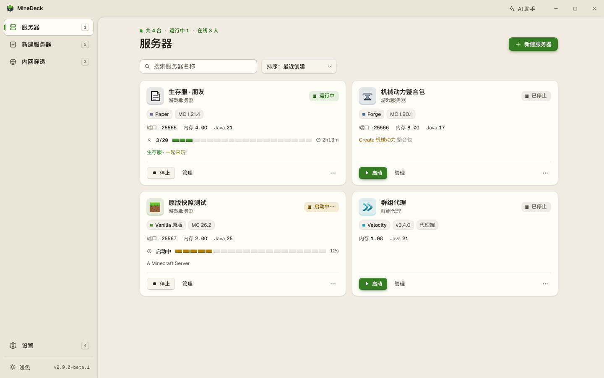

下载并把 `MineDeck.exe` 放进专门文件夹双击后，只要通过一次 Windows SmartScreen 提示，几秒内就会看到 MineDeck 主窗口。

## 首次引导与协议确认 {#onboarding}

第一次启动时，程序会弹出初始引导与《用户协议与免责声明》确认。同意后才不再每次弹出；即便当时跳过，后续也能从新建服务器直接上手。

还没有任何服务器时，主页会直接显示引导卡片：
- 如果想从头搭一台，点击主按钮直接进入 [从零创建](../server-setup/create-server.md) 向导；
- 如果手里已有整合包、地图或交接包，切换到侧栏 **「新建服务器」** 选择对应入口。

## 左侧主导航与快捷键 {#sidebar}

主界面左侧栏固定为 5 个一级页面，可用键盘数字键 `1`～`5` 快速切换（输入框未聚焦时生效）：

| 快捷键 | 入口 | 用途 |
| --- | --- | --- |
| `1` | **「服务器」** | 查看全部服务器状态、一键启动 / 停止、直显局域网连接地址、右上角查看后台任务汇总 |
| `2` | **「新建服务器」** | 5 种开服入口：从零创建、导入整合包、用已有地图开服、导入交接包、接管已有服务器 |
| `3` | **「内网穿透」** | 管理自定义隧道，绑定 OpenFrp / 樱花穿透账户并导入/创建公网隧道 |
| `4` | **「工具箱」** | **离线皮肤包生成** 与 **导出 Modrinth 整合包（`.mrpack`）**，不改动现有服务器 |
| `5` | **「设置」** | 全局外观、下载源、存储位置、Java 运行时、手机远程管理、Webhook 通知、AI 与 MCP、开机启动与更新 |

左侧栏最底部还有三个小按钮：快速切换 **浅色 / 深色模式**、**「退出 MineDeck」**（会先优雅保存世界并关闭正在跑的服务器与隧道再退出）以及当前版本号显示。

## 服务器详情页的 7 个标签 {#instance-tabs}

在 **「服务器」** 列表点进任一台服务器，页面顶部会显示 **核心版本、运行状态、局域网连接地址（点击可复制）**，以及 **「启动」**、**「停止」**、**「重启」**、**「打开目录」** 和 **「···」** 更多菜单（可切换展示 IP、导出交接包、移出列表或删除）。

页头正下方是一条常驻提示区：若上次启动崩溃、有没装上的文件、Java 路径失效或模组需要更高 Java 版本，会直接固定在这里给出中文建议与修复按钮。

详情页按核心能力动态展示最多 **7 个标签**（对代理端或原版不适用的标签会自动隐藏）：

1. **「控制台」**：实时日志（支持 UTF-8 / GBK 切换、过滤、命令历史与 Tab 补全）及顶部报错横幅。
2. **「玩家」**：在线玩家、白名单开关与增删、管理员（OP）、踢出与封禁（代理端无此标签）。
3. **「世界与备份」**：拆分为 **「备份」**（立即备份 / 还原 / 删除）与 **「换地图」**（上传地图、查看预览、多恢复点依次换回）两个子页（代理端无此标签）。
4. **「插件」 / 「模组」 / 「插件和模组」**：按核心类型显示对应名称（原版无此标签）。上半区管理已装文件（启用 / 停用 / 删除），下半区搜索 Modrinth、筛选热门、从电脑添加本地 jar 并使用 **待装清单** 自动查前置。
5. **「定时任务」**：每日 `HH:MM` 定时执行重启、命令或备份，以及崩溃自动重启策略。
6. **「设置」**：拆分为 **「常用」**（78 项配置分组与即时生效标注）、**「启动与内存」**（调内存 / 选 Java / 额外 JVM 参数）与 **「全部配置」**（代理端仅显示「启动与内存」）。
7. **「扩展」**：仅在核心和版本满足条件时出现，依次包含 **「游戏内 AI」**、**「AI 伙伴」** 和 **「音乐共享」**。

## 标题栏「AI 助手」入口 {#titlebar-ai}

在顶部标题栏右侧（靠近窗口最小化/最大化按钮左侧），可以看到 **「AI 助手」** 按钮：

- 未在设置里启用 AI 时，在局域网设备上不会显示入口；本机可点击弹出提示并直达配置。
- 当你配置好 AI 或启用 **MCP 接口** 时，如果有待你拍板确认的操作提案，按钮旁会亮起小提示点，点击即可滑出右侧对话与确认面板，边缘支持拖拽调宽（`320px`～`720px`）。详情见 [应用内 AI 助手能做什么](../ai-and-mcp/ai-assistant.md)。

## 外观主题与自定义背景 {#appearance}

在 **「设置 → 外观」** 中，你可以随时按设备独立定制界面风格（设置存放在当前浏览器或窗口的本地存储里，电脑和手机远程页面可分别配不同配色）：

- **主题模式**：`跟随系统`、`浅色`、`深色`。
- **7 套配色方案**：方块（默认）、Fluent、GitHub、石墨、Nord、Catppuccin、Solarized。
- **8 种强调色**：蓝、靛蓝、紫、青、绿、橙、玫红、石墨，或选择 `跟随配色方案`。
- **自定义界面背景图**：在 `MineDeck.exe` 同级目录新建一个名为 `bg` 的文件夹，放进任意常见图片文件，程序即可将其作为界面背景。

> [!TIP]
> 在原生的 Windows 桌面窗口里，切换界面主题色后会自动同步更新窗口标题栏底色，下次冷启动时不会闪白屏。窗口内点击 GitHub、EULA、Modrinth 等外部网页链接，也会自动调用你的默认浏览器打开，方便直接利用已有登录状态。
