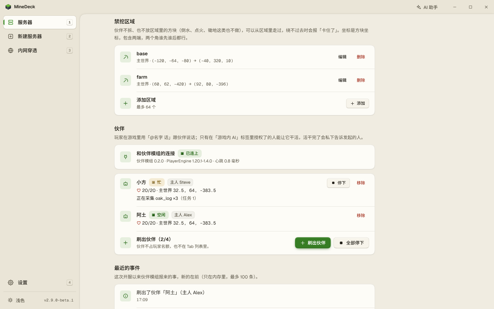

开启 **AI 伙伴** 后，Minecraft 服务器里会出现像真实角色一样的伙伴实体（不占用玩家人数槽位，也不出现在 Tab 玩家列表中），随游戏存档保留。你在聊天栏里直接用 `@伙伴名 指示` 对话，由 MineDeck 里的 AI 大模型听懂意图后调度伙伴做动作（模型均由宿主电脑调用，伙伴模组不连第三方游戏账号）。

> [!NOTE]
> **版本与实测边界**
> - 目前 **仅支持 `NeoForge 1.21.1`**（需 NeoForge `21.1.x`）与 **`Forge 1.20.1`**（需 Forge `47.x`），随程序内置的伙伴模组版本为 **`0.2.1`**。其他核心与版本在 **「扩展」** 下不会开启（或显示不支持）。
> - 页面顶栏与内部小标题目前按原设计保留称呼「伙伴」与开关 **「打开伙伴」**，入口标签位于详情页 **「扩展 → AI 伙伴」**。
> - **实测状态提示**：核心功能均已在开发测试环境中验证，但**在多人真实客户端同时连接游玩的完整端到端场景（含无授权防误触发测试）尚需在 Windows 真服进一步实机积累验收**。建议先在测试世界体验后再用到正式长期周目。

## 准备前提与服务端安装 {#install}

1. **先配全局 AI 与打开游戏内授权**：
   - 在侧栏 **「设置 → AI（可选）」** 配置好服务商与 Key；
   - 打开这台服务器 **「扩展 → 游戏内 AI」**，在 **「能让 AI 执行命令的玩家」** 中勾选允许控制伙伴的游戏玩家名（**只有「游戏内 AI」授权过的玩家才叫得动伙伴干活**，其他人喊伙伴只会被婉拒要求找服主授权）。
2. **安装服务端需要的 3 个模组**：
   打开详情页 **「扩展 → AI 伙伴」**（旧图所示「伙伴」页），在顶部 **「安装」** 一栏查看缺失项并点击 **「安装」**：
   - **伙伴模组**（如 `minedeck-companion-neoforge-1.21.1-0.2.1.jar`）：直接从 MineDeck 内置包写出到 `mods\`；
   - **PlayerEngine**（如 `1.21.1-1.4.0` / `1.20.1-1.4.0`）与 **Architectury API**：程序按实测可兼容版本范围自动从 Modrinth 拉取并安装（不会盲目追新版本导致接口不兼容），装完后重启一次服务器。

## 好友客户端需要装什么？ {#client-install}

> [!IMPORTANT]
> **好友的客户端只装伙伴模组这 1 个 jar 即可！不用装 PlayerEngine 和 Architectury API。**
> - 到官网 [下载页](/download/)（展开附带模组文件）或 GitHub 对应版本 Release 页下载与服务器相同加载器（`neoforge-1.21.1` 或 `forge-1.20.1`）且版本号匹配的伙伴模组 jar（若以前装过 `0.2.0`，须删掉旧版换新版），放进客户端的 `.minecraft\mods\` 目录（若启动器开了版本隔离则放对应版本目录的 `mods\`）。
> - **如果这台服务器本身还装了整合包或其他必装内容模组**，好友仍须安装同一份整合包及全部其余模组，否则即使装了伙伴模组也会被服务器拦在门外。
> - 如果有好友客户端忘了装伙伴模组直接进服，服务端会在连接阶段主动拦下并显示清晰的中文提示，告知需要安装的精确文件名。

## 在网页管理页配置与召唤伙伴 {#manage}

安装完重启进服后，页面连接状态会变成 **「已连上」**：

- **打开「打开伙伴」开关**：全局总开关；停服或退出 MineDeck 时，伙伴实体与进度留在存档中，下次重开自动接管。
- **伙伴数量上限**：默认最多同时拥有 **4 个**伙伴，可在 **1～16** 之间调整。
- **刷出与移除**：在网页「伙伴」列表点击刷出伙伴，填入 **伙伴名字**（1–16 字，不含空格、`@`、`/`、`、`、`:` 等符号以免聊天 `@名字` 解析出错）和主人账号名；不需要时可在列表移除或令当前任务立刻停下。
- **设置「不许打的生物」与「禁挖区域」**：
  - 未自定义禁打名单时使用内置保守默认列表（避免伙伴误杀村民、猫、宠物等）；
  - 可在网页填写方形方块坐标划定 **禁挖区域**（支持指定主世界/下界/末地，伙伴会在保护区内跳过破坏/放方块/倒水，仅能走过）。

## 游戏里怎么用聊天指挥伙伴？ {#commands}

获得授权的玩家进入游戏后，在聊天栏输入 **`@伙伴名 指令`**（例如 `@小方 跟着我`）：

- **跟随**：`@小方 跟着我` / 跟在指定玩家身边；
- **采集**：`@小方 砍 10 个橡木原木` / 采集矿石与常见方块（自动避开禁挖区）；
- **前往坐标**：`@小方 去 120 64 -80`；
- **攻击生物 / 守卫**：`@小方 打旁边的僵尸`（受禁打生物限制）；
- **交出物品**：`@小方 把身上的原木都给我`（会按实际交出数量私下反馈）；
- **停下 / 说话 / 查看状态**：停住的伙伴落入水里会自动浮起防止淹死；任务完成或无法绕路（卡住）时，都会通过私聊只告知发起请求的玩家。

> [!TIP]
> 在 **「扩展 → 游戏内 AI」** 设置的「每人冷却（默认 8 秒）」和「全服每天总次数（默认 300 次）」是和叫伙伴共享配额的，不过每名玩家每天叫伙伴单独有 60 次额度计算。如果觉得不够用可以在那里调高限额。
