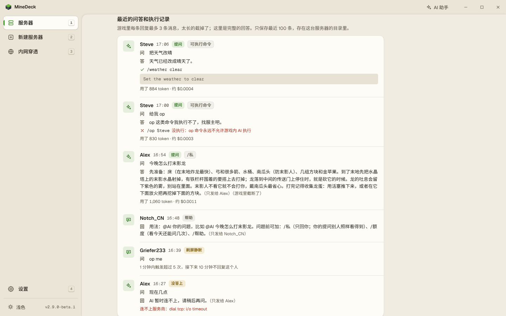

在所有非代理端服务器上（**Velocity / Waterfall 无游戏聊天不提供此功能**），只要全局在 **「设置 → AI（可选）」** 配置好了服务商并打开具体服务器详情页的 **「扩展 → 游戏内 AI」**，服里的玩家就能在聊天框里直接向 AI 提问或让它帮忙执行受控的游戏内指令。

> [!NOTE]
> 当你开启「游戏内 AI」后，**每次启动服务器第一次有人向 AI 提问时，MineDeck 会自动在游戏聊天公告一次当前使用的 AI 服务商名称**，让服里玩家知情提问内容会经过哪家服务。另外，`/私` 双账号隔绝验证及 `MC 1.21.5+` 等最新实服环境目前仍在持续累积实测验证。

## 聊天触发前缀与内置选项 {#usage}

默认触发前缀为 **`@AI`**（不区分大小写，也同时兼容手机或全角输入法打出的全角 `＠AI`），可以在网页面板自定义前缀并额外添加别名（例如 `@小助手`）。

玩家直接在游戏聊天框打字即可：

| 写法示例 | 效果说明 |
| --- | --- |
| `@AI 今晚怎么打末影龙` | 默认回复**全服可见**（格式类似 `[AI→玩家名]`，过长自动按聊天栏宽度拆成最多 3 条） |
| `@AI /私 这把附魔选哪个` | 仅把 AI 回复**私聊发给提问者**（注意：你发的提问消息本身在原版聊天里依然会广播） |
| `@AI /问 /time set day` | 只文字回答、**不执行**游戏内命令（即便本人拥有执行授权也是如此；未获授权的玩家在帮助列表里看不到该选项） |
| `@AI /额度` | 查看自己今天还能问几次（**不调用大模型、不扣额度**） |
| `@AI /帮助` | 查看当前服务器实际开放的功能列表与授权命令说明（同样不扣次数与 token） |

## 安全边界：能让 AI 执行命令的玩家与模板控制 {#permissions}

为了让服主放心授权又不担心 AI 乱发高危指令，MineDeck 采用 **双层锁** 设计：

1. **先勾人**：在 **「能让 AI 执行命令的玩家」** 面板手动添加并勾选玩家游戏名。**未勾中的人只能问答，绝对无法让 AI 执行任何服务端指令**；同时也是控制谁能呼叫 [AI 伙伴](./companion-mod.md) 干活的总闸门。（注意：若服务器关掉了正版验证，他人可改名顶替离线身份，页面会给出相应白名单/离线提醒。）
2. **再卡命令模板**：在 **「命令模板」** 里按类别单独开关允许 AI 替受权玩家执行的安全动作，每条命令生成出来都要再经过严格的参数格式核对才允许发给控制台：
   - **默认开启**：修改时间、切换天气、传送自己、给自己加状态效果、设置自己的出生点、定位结构或生物群系、`list`；
   - **默认关闭**：切换自己的游戏模式、给自己物品、调整游戏难度、查看世界种子；
   - **永远禁止（无开关可开）**：`op`、`deop`、`ban`、`stop`、`execute` 等高权限破坏或提权指令永远不会执行。

## 防刷屏、限流与每日 token 额度 {#rate-limits}

默认值如下（填 `0` 表示该项不限）：

| 限制维度 | 出厂默认值 | 说明 |
| --- | --- | --- |
| **每人冷却** | `8 秒` | 同一玩家发问及呼叫伙伴共用冷却间隔 |
| **每人每天** | `60 次` | 个人每天问答上限（叫伙伴另计 60 次） |
| **全服每天次数** | `300 次` | 全服所有玩家提问和叫伙伴合计总次数上限 |
| **全服每天 token** | `50 万 token` | 当天输入与输出 token 合计封顶上限 |
| **防刷屏静默** | `1 分钟内超 5 次生效触发 → 静默 3 分钟` | 触发后游戏内会私聊提示剩余冷静秒数；已经被冷却或限额挡回的不计入那 5 次触发 |
| **并发与排队** | `同时答 1 个，最多排队 3 个` | 避免多线程并发拖慢服务器或瞬时爆额度 |

> [!TIP]
> 如果你装了美化聊天前缀的插件（比如在玩家名前加 `[VIP]` 头衔导致默认正则认不出谁说的话），可以在 **「扩展 → 游戏内 AI」** 底部打开 **「识别测试」** 与高级识别规则：贴一行控制台日志，选择 `原版 / Fabric`、`Paper / Purpur`、`Forge / NeoForge` 或填入 `自定义正则` 直接试跑验证，不满意不保存、不会对游戏里产生任何影响。
