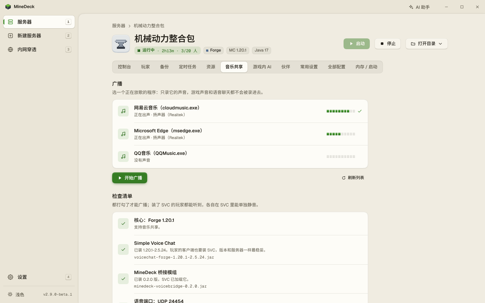

**音乐共享** 可以实时采集你当前开服电脑上播放软件发出的声音，通过本机连接交给服务器里的 `minedeck-voicebridge` 桥接模组，再经由 **Simple Voice Chat（简单语音聊天，简称 SVC）** 以立体清晰的音频频道推给服里所有装了 SVC 的玩家，玩家还能自己在游戏内按语音菜单的「调整音量 → MineDeck 音乐共享」把音乐调轻或静音而不影响聊天说话。

> [!NOTE]
> **适用范围与真机测试说明**
> - **支持的核心与版本**：目前**仅支持 `NeoForge 1.20.5+`、`Forge 1.20.1+` 与 `Mohist 1.20.1+`**。`Fabric` 与 `Taiyitist`（原 Banner）目前没有桥接模组，详情页 **「扩展」** 中不显示音乐共享。
> - **开发验证情况**：桥接协议与服务端插件逻辑已在本地虚拟测试环境通过自动化校验，在**海量复杂真机 MC 客户端听歌及 OpenFrp UDP 语音穿透节点的实机联调仍在继续验证完善中**。
> - **同一时间只能为一服广播**，且 **「开始广播」只能在开服主机本机操作**（无法由远程手机端或 AI 助手 / MCP 启动，局域网设备允许停止正在进行的广播）。

## 第一步：通过页面的检查清单 {#checklist}

进入具体服务器详情页 **「扩展 → 音乐共享」**，在广播控制下方的 **「检查清单」** 全部亮绿打勾后即可开播：

1. **Simple Voice Chat（SVC）**：服务端必须装有 SVC；若未安装，点按钮可直接按当前加载器与版本从 Modrinth 安装，装完重启一次服务器（记得 **每一位来听歌的好友客户端也必须安装同一版本的 Simple Voice Chat**，好友无需装 MineDeck 桥接模组）。
2. **桥接模组（`minedeck-voicebridge`）**：随 `MineDeck.exe` 内置携带（当前 `0.2.0`），点击一键写进 `mods\` 目录（安装时逐字节核对 SHA-256，写完重启服务器；如极个别服务器环境默认注解扫描找不到插件，页面也支持切换备用 `javafml` 变体包）。
3. **语音监听端口与穿透**：SVC 需要独立开放 UDP 语音端口——
   - 若大家在同一局域网，保证防火墙放行或局域网连通即可；
   - 若好友通过**内网穿透跨网联机**，一定要在 **「内网穿透」** 为这台服务器**再专门加一条「语音」用途的 UDP 隧道**！语音隧道启用后，MineDeck 会自动把拿到的公网地址填入 SVC 的 `voice_host` 配置中（如果你自己改填过别的值则不会覆盖）。

## 第二步：选择音源、排除自己回声并开播 {#broadcast}

- **Windows 11（单应用精准采集）**：可从正在出声的程序列表里单独挑出音乐软件（如网易云音乐、QQ 音乐、Spotify 或浏览器页面）只采它和其子进程，程序列表会自动剔除系统提示音、MineDeck 自己与 Minecraft 游戏进程本身。
- **Windows 10（整机混音模式）**：受限于操作系统音频接口能力，Windows 10 **仅能整机混音内录**——游戏声音和别人说话也会被再次录进去（首次使用须在页面确认一次知情提示）。
- **防止房主自己听出两遍（回声消除）**：如果你一边开服一边就在同一台电脑进游戏玩且正在外放音乐，在页内设置填入 **「我在游戏里的名字」**（支持多个名字或 UUID 逗号分隔），桥接模组会在 `2 秒内` 动态免重启把你列入广播排除名单——游戏里的其他玩家正常听，唯独不推回给房主本人。

> [!TIP]
> 切歌停顿时或停止播放后无声超过 `100 毫秒` 会平滑截断不再白发包；准备停服或退出 MineDeck 前，程序会先自动停止正在进行中的广播再安全关服，避免出现挂留进程。
