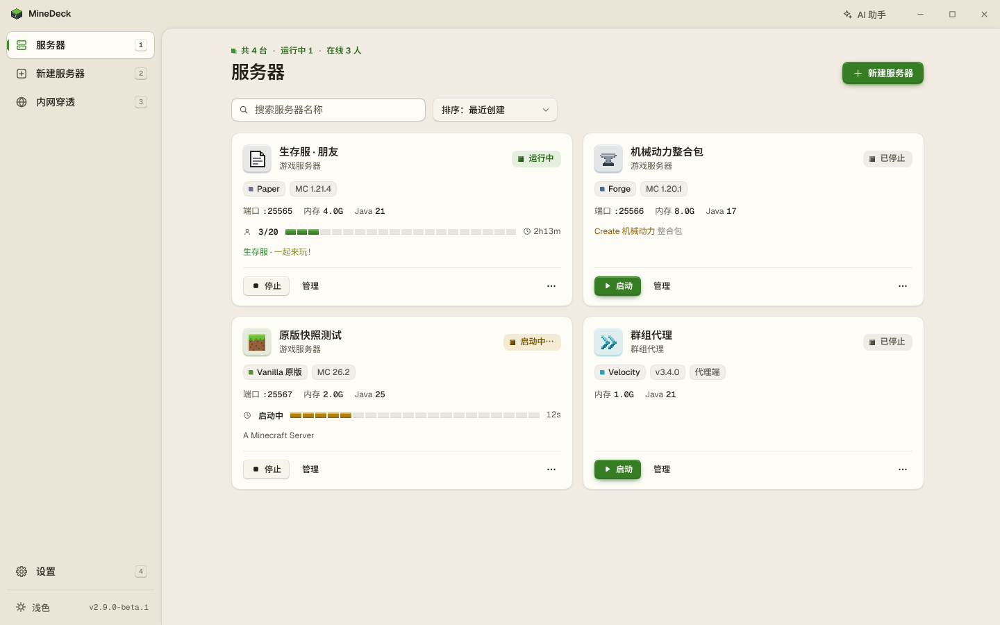

打开 MineDeck 后，左侧栏 **「新建服务器」** 进入新建页，里面有五种方式。服务器列表还是空的时候，主页上的主按钮 **「从零创建」** 会直接打开从零创建；另外四种在旁边的文字链里：导入整合包、用已有地图开服、导入交接包或接管已有服务器。

| 方式卡片 | 适用场景 |
| --- | --- |
| **「从零创建」** | 自己选核心与游戏版本，Java 与服务端由程序自动下载 |
| **「导入整合包」** | 导入 Modrinth `.mrpack`、CurseForge `.zip`，或作者打包的现成服务端压缩包 |
| **「用已有地图开服」** | 拿下载好的冒险/空岛地图或自己的单人存档直接建一台新服 |
| **「导入交接包」** | 导入别的 MineDeck 导出的 `.mdpack` 交接包（v3.1.0 起） |
| **「接管已有服务器」** | 把电脑上原本自己手动开好的服务器目录纳管进 MineDeck，文件不搬动（v3.1.0 起） |

本文介绍最常用的 **「从零创建」** 流程。

## 第 1 步：选择服务端核心 {#core}

向导第一步列出全部 12 种支持的核心，支持 Minecraft `1.12.2` 到最新正式版（包括年份编号的 `26.x`）：

- **纯原版**：`Vanilla 原版` — 官方纯净端，适合原汁原味联机（不支持装服务端插件或模组）。
- **插件服**：`Paper`、`Purpur`、`Leaves`、`Folia` — 性能好、可装 Bukkit/Paper 插件；其中 `Folia` 为多线程分支，部分老插件不兼容。
- **模组服**：`Fabric`（轻量、启动快）、`NeoForge`（1.20.2+ 现代主流模组加载器）、`Forge`（经典及 1.20.1/1.12.2 等大量旧模组）。
- **混合服**：`Mohist`（Forge + 插件）、`Banner`（Fabric + 插件）。注意此类混合核心要求**服务器所在文件夹路径不能含中文等非英文字符**。
- **群组代理**：`Velocity`（固定使用 Java 21）、`Waterfall`（固定使用 Java 17），用来把多台下游游戏服串起来，本身不承载世界存档。

## 第 2 步：选择 Minecraft 版本与构建 {#version}

- 选中核心后，挑选要开的 **Minecraft 版本**。版本号清单直接拉自对应核心官方接口。
- 具体的加载器构建号已收在 **「高级」** 折叠项里，一般保持默认推荐构建即可。
- 选择 **Java**：MineDeck 会按目标 MC 版本自动匹配电脑上已有的 Java；没有合适版本时自动下载便携式 Java（优先国内镜像），不改动你的系统环境变量。

## 第 3 步：填写基本设置并确认 EULA {#settings}

填写服务器名称并确认常用启动选项：

- 最大内存：这一步不能低于 `512 MB`。纯净原版或轻插件服一般给 `2048–4096 MB`，大型模组服建议 `6144–8192 MB`，给操作系统和客户端留出余量。接管已有服务器时沿用原来的配置，那边的内存滑条从 `1024 MB` 起。
- **端口**：默认避开 MineDeck 已有服务器以及同机正在监听的端口（如默认 `25565` 已被占会自动顺延）。

> [!NOTE]
> Windows 的 Hyper-V、WSL 或 Docker 有时会成段保留端口，打开新建表单时的预检查不会提前发现被系统保留的端口；若首次启动提示端口不可用，直接在页头或报错横幅点击 **「改端口」** 换一个端口即可。

- 正版验证默认关闭。白名单这一步的开关文案是 **「只允许白名单里的玩家进入」**，默认也是关的，避免第一次联机把还没加进名单的朋友挡在外面。从零创建、导入整合包、用已有地图开服这三步有这个开关。导入交接包沿用包里的配置，没有这个开关。接管已有服务器只读出原来的白名单是开还是关，不在这里改。26.3 及以上的服务端自己默认会打开白名单，MineDeck 会按向导里的开关写入 `server.properties`。开服后要限制玩家，到 **「玩家」** 页加人并打开白名单。
- **同意 Minecraft EULA**：除群组代理端（Velocity / Waterfall）外，创建正式游戏服须先阅读并勾选同意 Mojang 最终用户许可协议。

## 可选步骤：顺手「选模组 / 插件」 {#modcart}

如果选的是非原版核心（如 Paper、Fabric、NeoForge、Forge），向导还有可选的 **「选模组」**（插件服对应选插件）。这一步从 v3.1.0 起才有：

- 左侧直接列出 Modrinth 上适合当前核心和版本的热门项目、分类筛选与关键词搜索，也能点 **「从电脑添加」** 导入本地 `.jar`。
- 加入右侧 **「待装清单」** 后，创建完服务器会自动补齐必装前置并一次性装好，跳过仅在客户端生效的模组。

这一步也可以直接跳过，开好服之后随时在服务器详情页的 **「模组」** / **「插件」** / **「插件和模组」** 标签再挑。

## 启动与连接测试 {#launch}

1. 点 **「开始创建」**，在后台任务页等待下载核心、安装加载器并完成登记。部署期间切页或刷新，可以回到任务列表看进度；必要阶段可以取消。
2. 进入服务器详情页（或回到「服务器」列表），点击 **「启动」**。
3. 切到 **「控制台」** 标签，看到输出类似下面的字样即表示开服成功：

```text
Done (2.418s)! For help, type "help"
```

4. 同一个局域网下的朋友，直接点击页头显示的 **连接地址**（`局域网IP:端口`）复制给对方即可进服；不在同一网络的朋友，请接着配置 [内网穿透与平台账户](../networking/tunnels-and-accounts.md)。



> [!TIP]
> 如果启动失败并弹出红色或黄色横幅提示，可先对照 [控制台报错横幅索引](../troubleshooting/error-banner-index.md) 定位原因，通常不需要自己翻完整日志。
