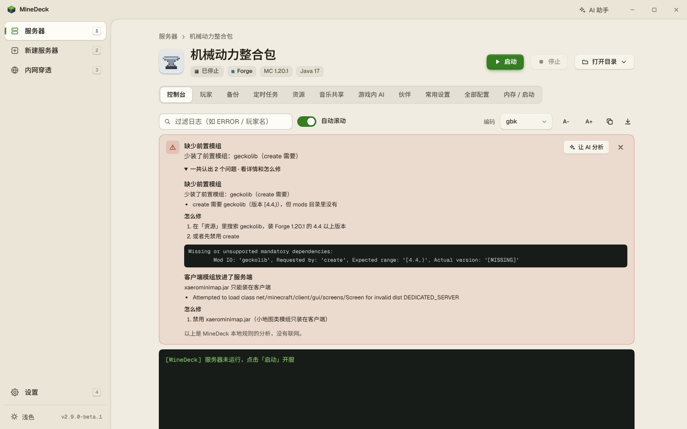

当服务器没能正常启动、崩溃退出，或好友因为模组对不上被断开时，**「控制台」** 顶部会自动显示中文报错横幅（无需开启 AI）。下面整理了程序内置的全部 **14 条独立诊断规则** 与对应的原始报错关键词，你可以直接在站内搜索报错里的英文关键词定位到对应条目。

> [!TIP]
> 如果你已经在全局设置了 AI 服务商，报错横幅旁会出现 **「让 AI 分析」** 按钮，AI 会结合本次完整日志、配置和崩溃报告给你具体排查步骤。也可以点击弹窗右下角 **「复制报错信息」** 发给朋友或到 [反馈页](/feedback/) 求助。

## 总览速查表 {#overview}

| 横幅标题 | 日志常见英文关键词 | 常见处理入口 |
| --- | --- | --- |
| 缺少前置模组 | `MISSING` / `Missing or unsupported mandatory dependencies` | 详情页 **「模组」** / Modrinth 补齐前置 |
| 客户端模组放进了服务端 | `Attempted to load class ... for invalid dist DEDICATED_SERVER` | 详情页 **「模组」** → **「停用」** |
| 装错加载器 | `is a Fabric mod` / `Bukkit` / `Could not load '.jar'` / `plugin.yml` | 更换为对应加载器的版本 |
| 重复模组 | `Found duplicate mods` / `present in multiple files` | 只保留最新版，旧版 **「停用」** 或 **「删除」** |
| 模组之间声明不兼容 | `Incompatibilities between mods` / `is incompatible with` | 二选一禁用其中一个 |
| Mixin 冲突 | `MixinApplyError` / `InvalidMixinException` / `MixinTransformerError` | 更新相关模组，或禁用新装同类模组 |
| Java 版本不对 | `UnsupportedClassVersionError` / `class file version` / `URLClassLoader` | 详情页 **「设置 → 启动与内存」** 换 Java |
| JVM 参数不被支持 | `Unrecognized VM option` / `Could not create the Java Virtual Machine` | 详情页 **「设置 → 启动与内存」** 删掉不兼容参数 |
| 端口被占 | `FAILED TO BIND TO PORT` / `Address already in use` / `BindException` | 页头 **「改端口」** 或关掉占端口程序 |
| 内存不够 | `OutOfMemoryError` / `Could not reserve enough space for object heap` | 详情页 **「设置 → 启动与内存」** 调整内存 |
| 卡死被看门狗关掉 | `A single server tick took ... seconds` / `server will forcibly shutdown` | 查 `Server thread` 堆栈，更新卡顿模组或调视距 |
| 没同意 EULA | `You need to agree to the EULA in order to run the server` | 阅读协议后手动修改 `eula.txt` |
| 好友进不来（模组对不上） | `Mod rejections` / `mismatched mod channel list` / `incompatible voice chat version` | 让好友客户端与服务端保持一致版本 |
| 配置文件被改坏 | `Failed loading config file` / `nightconfig.core.io.ParsingException` / `Invalid TOML` | 备份后删掉损坏配置让其重新生成 |

---

## 1. 缺少前置模组 {#missing-deps}

- **横幅常见说明**：少装了前置模组，或前置版本不满足要求。
- **怎么办**：
  1. 横幅会尽量列出缺失的模组 ID（以及是谁需要它）。
  2. 打开服务器详情页的 **「模组」** 标签搜索该前置 ID 下载安装（或者利用待装清单重新核对前置）；版本不对的换成满足要求的版本。
  3. 注意：如果服务端装了新模组及前置，好友的客户端通常也需要一起补上。

## 2. 客户端模组放进了服务端 {#client-only}

- **原文线索**：`Attempted to load class ... for invalid dist DEDICATED_SERVER`
- **原因**：把小地图、界面美化、光影控制、音效增强等只在玩家电脑运行的模组放进了服务端 `mods` 里（注意：MineDeck 会自动放过 AI 伙伴依赖 `PlayerEngine` 的无害检查警告，其余模组则会触发提示）。
- **怎么办**：停服后到详情页 **「模组」** 找到该文件点 **「停用」**（或在 `mods` 目录改名为 `.jar.disabled`），**玩家自己的客户端保留即可**。

## 3. 装错加载器 {#wrong-loader}

- **原文线索**：`File ... is a Fabric mod` / `for Minecraft Forge or an older version of NeoForge` / `plugin.yml not found` / `is a Bukkit or Bukkit-implementor`
- **原因**：比如在 NeoForge 服放进了 Fabric 或 Forge 模组，或把模组丢进了 Paper 插件服的 `plugins` 目录。
- **怎么办**：在详情页停用或删除放错的文件，重新下载对应核心与相同 MC 版本的正确文件。

## 4. 重复模组 {#duplicate-mods}

- **原文线索**：`Found duplicate mods`、`Mod ... is present in multiple files`
- **原因**：同一个模组更新后忘了删旧版 `.jar`，或导入包后手工复制导致 `mods` 里同时存在两个版本。
- **怎么办**：停服后保留版本号较新的那一份，旧的在 **「模组」** 里点 **「停用」** 或 **「删除」**。

## 5. 模组之间声明不兼容 {#incompatible-mods}

- **原文线索**：`Incompatibilities between mods`、`Found incompatible mods`、`Mod A is incompatible with B`
- **怎么办**：这两个模组明确冲突不能同用，按你的需要二选一保留，在详情页把另一个停用。

## 6. Mixin 冲突 {#mixin}

- **原文线索**：`MixinApplyError`、`InvalidInjectionException`、`InvalidMixinException`、`MixinTransformerError`、`FAILED during APPLY`
- **原因**：模组注入修改游戏代码时发生碰撞或找不到目标，常见于核心小版本过旧、或者两个功能重叠的模组改同一处机制。
- **怎么办**：先尝试将该模组与核心加载器更新到同一 MC 版本下的较新版本；若仍崩溃，则与最近新装的同类功能模组二选一停用排查。

## 7. Java 版本不对 {#java-version}

- **原文线索**：`UnsupportedClassVersionError: ... class file version ... only recognizes class file versions up to ...`、`ClassLoaders$AppClassLoader cannot be cast to class java.net.URLClassLoader`、`Mod ... is missing a feature it requires to run`
- **常见对应**：1.16.5 及更早老版本 Forge 必须用 Java 8；1.18–1.20.4 通常用 Java 17；1.20.5–1.21 用 Java 21；26.1+ 用 Java 25。也有部分模组显式要求比游戏本身更高的 Java。
- **怎么办**：在详情页打开 **「设置 → 启动与内存」**，重新选择或点击让 MineDeck 下载横幅里建议的 Java 版本并保存。若以前自带的便携 Java 在解压时损坏，可到程序目录的 `runtimes` 删掉该版本号文件夹后让系统重新下载。

## 8. JVM 参数不被支持 {#jvm-option}

- **原文线索**：`Unrecognized VM option '...'` / `Unrecognized option:` + `Could not create the Java Virtual Machine`
- **原因**：在启动参数里填了当前 Java 版本不认识的 GC 开关或标志（例如老版本参数放到新版 Java，或拼写少了一个字母）。
- **怎么办**：打开详情页 **「设置 → 启动与内存」**，删掉提示中报错的 JVM 参数，或换用支持该参数的 Java 版本。

## 9. 端口被占 {#port-in-use}

- **原文线索**：`**** FAILED TO BIND TO PORT`、`Address already in use`、`java.net.BindException`、`Unable to initialize query/rcon`
- **原因**：上次进程没关干净、开了两台同端口的服务器，或者被本机其他软件 / Query / RCON 占用了端口。
- **怎么办**：
  - 若被 MineDeck 里的另一台服务器占着，页头和横幅会直接给出 **「改成 N 并启动」** 按钮，点一下自动顺延端口。
  - 若被其他程序占着，可关掉占用程序，或者点 **「改端口」** 到设置页改 `server-port`（别忘了通知好友连接新端口）。

## 10. 内存不够 {#out-of-memory}

- **原文线索**：
  - 开不起来：`Could not reserve enough space for ... object heap`、`There is insufficient memory for the Java Runtime Environment to continue`、`Invalid maximum heap size`
  - 运行中崩溃：`OutOfMemoryError: Java heap space` / `GC overhead limit exceeded` / `Metaspace`
- **怎么办**：
  - 若是“可用内存不足开不起来”：在 **「设置 → 启动与内存」** 调小最大内存（一般比当前本机剩余可用内存少留出 `1–2 GB`），或关闭浏览器、大型程序后再启动。
  - 若是运行中提示 `Java heap space`：适当调高最大内存（大型模组服通常需要 `6144–8192 MB`）。
  - 若是 `Metaspace`：在 JVM 参数中去掉 `-XX:MaxMetaspaceSize` 类上限参数并适当增大总内存。

## 11. 卡死被看门狗关掉 {#watchdog}

- **原文线索**：`A single server tick took ... seconds (should be max 0.05)`、`Considering it to be crashed, server will forcibly shutdown`
- **原因**：服务端主线程单个游戏刻卡住超过了看门狗上限（默认 `60000` 毫秒）。
- **怎么办**：
  - 查看崩溃报告 `crash-reports/` 里 `Server thread` 堆栈定位卡住主线程的模组并更新或停用。
  - 如果是跑图加载新地形太吃资源，可到 **「设置 → 常用」** 减小 **视距**（`view-distance`）与 **模拟距离**（`simulation-distance`）。
  - 万不得已才将 **卡死超时**（`max-tick-time`）设为 `-1` 关闭看门狗（关闭后若真的假死不会自动关闭重启）。

## 12. 没同意 EULA {#eula}

- **原文线索**：`You need to agree to the EULA in order to run the server`
- **怎么办**：如在外部接管或自己改过文件导致未同意协议，请先阅读官方 EULA（`https://aka.ms/MinecraftEULA`）；若确认同意，**手工**打开该服务器文件夹下的 `eula.txt`，将 `eula=false` 改为 `eula=true` 并保存重启。（此协议必须由人自己决定，AI 工具也不会代你勾选或改写。）

## 13. 好友进不来（模组对不上） {#client-mismatch}

- **横幅等级**：提示级（黄色警告，服务器本身照常运行，但有好友登录被断开）。
- **原文线索**：`Channel of mod ... failed to connect`、`You are trying to connect to a server that is running Forge/NeoForge, but you are not`、`has incompatible voice chat version`、`Mod rejections`、`mismatched mod channel list`
- **怎么办**：
  - 请好友使用与服务端一致的加载器（不要用原版客户端连模组服），并把服务端新加/变更的模组同步发给好友。
  - 若报错涉及 `Simple Voice Chat`（`voicechat`），须保证客户端与服务端安装相同兼容协议号的版本；若开启了 AI 伙伴，好友也须安装对应版本伙伴模组。

## 14. 配置文件被改坏 {#broken-config}

- **原文线索**：`Failed loading config file ...`、`nightconfig.core.io.ParsingException`、`Invalid TOML`
- **原因**：手动编辑 `config/` 或 `serverconfig/` 下的 `.toml` / `.json` 等文件时少了引号、中括号或等号。
- **怎么办**：停服后先备份该问题配置文件，再将其删除或还原为默认内容，让模组下次启动时重新生成一份；如果只需要保留少量修改，核对报错文件名并修复语法错漏后重开即可。
